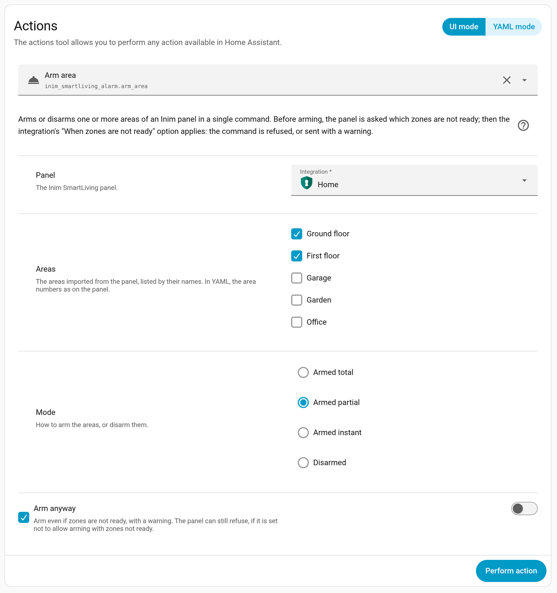
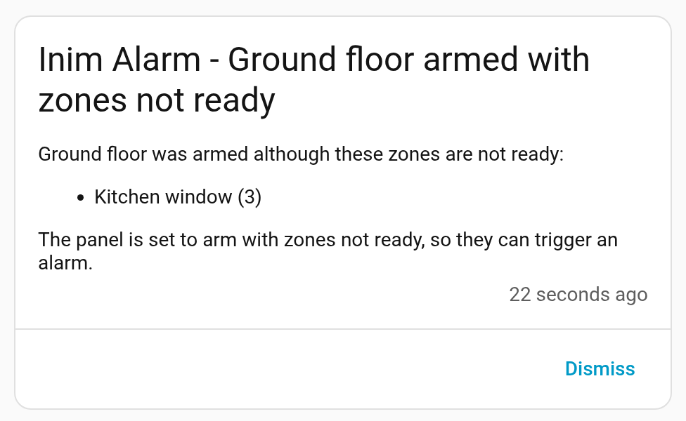

# Actions and events

This page shows how to arm, disarm and run scenarios from dashboards and automations, and how automations can react to the integration's events. The [reference](#actions) at the end lists every field.

## From a dashboard

*   **The whole panel**: add the alarm panel entity to Home Assistant's alarm panel card. Its buttons run the scenarios you mapped in the [options](options.md#initial-options).
*   **One area**: add the area's switch (on arms, off disarms) or its arming mode select (choose the mode). A tile card with the select's options feature shows the modes as a list:

    { width="400" }
    { width="400" }

*   **A scenario**: add its button.
*   **An output**: add its switch or light (see [Outputs](entities.md#outputs)).

## Arming areas from automations

Use the **Arm area** action to arm or disarm one or more areas of a panel in a single command, so they change together. In the automation editor, add the action **Arm area**, pick the panel, tick the areas and choose the mode:

{ width="600" }

In YAML, `areas` are the area numbers as on the panel:

```yaml
action: inim_smartliving_alarm.arm_area
data:
  config_entry_id: your_config_entry_id
  areas: [1, 3]
  mode: partial
```

To run a scenario from an automation, use **Activate scenario** (see [below](#action-activate-scenario)). You can try any action from **Settings** → **Tools** → **Actions** (on versions before 2026.11, **Developer tools** → **Actions**).

## Resetting the alarm memory

After an alarm, the panel keeps the alarm memory of the areas involved until it is reset; the *Area N alarm memory* sensors show it. The **Alarm Reset** action resets every area of the panel that has an alarm or tamper memory:

```yaml
action: inim_smartliving_alarm.alarm_reset
target:
  entity_id: alarm_control_panel.your_panel_name
```

You can call it from a script, an automation or a dashboard button.

## Zones not ready

Before it arms an area or runs a scenario, the integration asks the panel which zones are not ready: zones that are not at rest and would be armed. Then the option **When zones are not ready** (in **General settings**) decides:

*   **Refuse** (the default): nothing is sent. You get an error that lists the zones, for example *"Area 3 was not armed because these zones are not ready: Kitchen window (12)"*.
*   **Arm anyway and warn**: the command is sent, and a notification lists the zones. They can set off an alarm unless they are closed or bypassed in time.

    { width="480" }

`force: true` on the **Arm area** and **Activate scenario** actions arms anyway for that call, whatever the option says. Disarming is never checked. Either way, the [`inim_smartliving_alarm_zones_not_ready`](#event-zones-not-ready) event fires, for example to announce the open zones.

??? note "Which commands are checked, and the panel's own rule"

    *   **Checked**: the area switch, the arming mode select and **Arm area** (arming an area), and the scenario button, the alarm panel and **Activate scenario** (running a scenario).
    *   Zones the panel bypasses by itself when arming (autobypassable zones) are not listed.
    *   The installer can also set the panel itself not to allow arming with zones not ready. The integration reads that setting with the panel configuration and shows it in the *Refuses arming with zones not ready* sensor (and as `panel_refuses_not_ready` in the event). When it is on, the panel refuses such a command even when you arm anyway or use `force`: the integration still sends it, the message says the panel refused it, and the event's `action` is `refused_by_panel`.
    *   The panel's own rule depends on each zone's programming (for example, delayed zones do not stop total arming, and zones with `no_arming_if_not_ready` stop every mode), so it may let through zones the integration lists. When the setting is off, the panel arms whatever the zones' programming says.

## The event log on a dashboard

A Markdown card shows the last events of the [event log sensor](entities.md#sensors). Replace `sensor.home_event_log` with your event log sensor's ID:

```yaml
type: markdown
title: Alarm events
content: >-
  
  - {{ as_timestamp(e.timestamp) | timestamp_custom('%d/%m %H:%M') }}
  · {{ e.description_local }} · {{ e.authorized_by }} · {{ e.affected_areas }}
  
```

The repository's [Examples](https://github.com/matteoraf/ha-inim_smartliving_alarm_panel/tree/main/Examples) folder has a larger dashboard, made for version 0.3: its entity IDs and some cards may need changes.

## Actions

None of the actions returns a response. If a command is not carried out, the action fails with a message that says why (see [When the panel refuses a command](troubleshooting.md#when-the-panel-refuses-a-command)).

### Arm area { #action-arm-area }

`inim_smartliving_alarm.arm_area`: arms or disarms one or more areas of a panel in a single command. Before arming, it checks the zones (see [Zones not ready](#zones-not-ready)).

| Field | Required | Type and values | Default | Example |
|---|---|---|---|---|
| `config_entry_id` | yes | the panel (a list of your panels in the editor) | – | `01J…` |
| `areas` | yes | a list of area numbers, as on the panel; the editor lists the imported areas by name | – | `[1, 3]` |
| `mode` | yes | `total`, `partial`, `instant`, `disarm` | – | `partial` |
| `force` | no | `true` arms even if zones are not ready | `false` | `true` |

??? note "When it fails"

    *   With several panels, the editor shows each area number with the name it has on every panel that imports it; the panel you pick decides which one is armed.
    *   An area that is not imported from that panel (for example, one you unticked after writing the automation) is refused with a message, and nothing is sent.
    *   It also fails when the panel is not found or not loaded, when zones are not ready and the option says *Refuse*, and when the panel refuses the command.

### Activate scenario { #action-activate-scenario }

`inim_smartliving_alarm.activate_scenario`: runs a scenario of the panel. Before running it, it checks the zones (see [Zones not ready](#zones-not-ready)).

| Field | Required | Type and values | Default | Example |
|---|---|---|---|---|
| `config_entry_id` | yes | the panel | – | `01J…` |
| `scenario` | yes | the scenario number, as on the panel (from 1); the editor lists the imported scenarios by name | – | `2` |
| `force` | no | `true` runs it even if zones are not ready | `false` | `true` |

```yaml
action: inim_smartliving_alarm.activate_scenario
data:
  config_entry_id: your_config_entry_id
  scenario: 2
```

A scenario that is not imported from that panel is refused with a message. A failed activation also shows a notification and fires the [`inim_smartliving_alarm_scenario_activation_failed`](#event-scenario-activation-failed) event.

### Alarm Reset { #action-alarm-reset }

`inim_smartliving_alarm.alarm_reset`: resets the alarm and tamper memory of every area of the panel that has one.

| Field | Required | Type and values | Default | Example |
|---|---|---|---|---|
| target `entity_id` | yes | the panel's alarm panel entity | – | `alarm_control_panel.home` |

Entities of other integrations in the target are skipped. If the panel's integration is not loaded, the action fails with a message.

### Re-read panel configuration { #action-reread-panel-configuration }

`inim_smartliving_alarm.reread_panel_configuration`: reads the panel configuration again and reloads the integration, like the button of the same name (see [Setup](setup.md#re-reading-the-panel-configuration)).

| Field | Required | Type and values | Default | Example |
|---|---|---|---|---|
| `config_entry_id` | yes | the panel | – | `01J…` |

```yaml
action: inim_smartliving_alarm.reread_panel_configuration
data:
  config_entry_id: your_config_entry_id
```

It fails, and keeps the stored configuration, when the panel cannot be reached, is in programming mode, or returns an incomplete configuration.

## Events

Automations can react to these events with an event trigger.

### Zones not ready { #event-zones-not-ready }

`inim_smartliving_alarm_zones_not_ready` fires each time an area is armed or a scenario is run with zones not ready, whether the command was refused or sent anyway.

| Field | Values |
|---|---|
| `config_entry_id` | the panel's configuration entry |
| `target` | the area's name, several area names separated by commas (from **Arm area**), or the scenario's name |
| `action` | `refused` (not sent), `armed_anyway` (sent with a warning), `refused_by_panel` (sent, and the panel refused it) |
| `zones` | the zones not ready, each with `zone_id` (the number) and `zone_name` (the zone's name on the panel, for example `Kitchen window`, or `Zone 12` when it has none) |
| `panel_refuses_not_ready` | `true` or `false`: whether the panel itself refuses arming with zones not ready; `null` before the configuration was read again by this version |

```yaml
triggers:
  - trigger: event
    event_type: inim_smartliving_alarm_zones_not_ready
```

### Scenario activation failed { #event-scenario-activation-failed }

`inim_smartliving_alarm_scenario_activation_failed` fires each time a scenario cannot be run: from the alarm panel, a scenario button or **Activate scenario**. A scenario refused because zones are not ready fires both events.

| Field | Values |
|---|---|
| `entity_unique_id` | the unique ID of the entity that ran it, or `<entry id>_activate_scenario_action` for the **Activate scenario** action |
| `entity_name` | the name of that entity, or the panel's entry title for the action |
| `action` | what was asked, in English, for example `arm away`, `activate scenario 'Night'` (the action) or `activate scenario 'Night' (index 1)` (a scenario button) |
| `scenario_index` | the scenario number minus 1 |
| `scenario_name` | the scenario's name |
| `reason` | `zones_blocked`, `no_areas_identified`, `unknown_zones_error`, `no_data_available`, `disarm_failed`, `panel_programming`, `command_failed`, `unknown`, or the reason the panel gave (see below), except `open_zones` and `refused`, which give `zones_blocked` or `unknown_zones_error` |
| `panel_result` | the panel's reason when it refused the command (`open_zones` and `refused` included), `unknown` for a reason the integration does not know, or `null` when the panel did not refuse it |
| `blocking_zones` | the zones that stopped it, each with `zone_id`, `zone_name`, `status` (`not_ready`, `alarmed`, `short` or `tamper`) and `areas` (by name) |
| `message` | a description, always in English, whatever Home Assistant's language |

The panel's reasons are `invalid_code`, `open_zones`, `code_not_enabled`, `already_in_state`, `slot_out_of_range`, `slot_not_connected`, `null_terminal`, `cannot_be_bypassed`, `no_areas`, `double_zone_error`, `output_not_enabled`, `areas_armed` and `refused`; what each means is on [Troubleshooting](troubleshooting.md#when-the-panel-refuses-a-command).

## Switching outputs

See [Outputs](entities.md#outputs).
