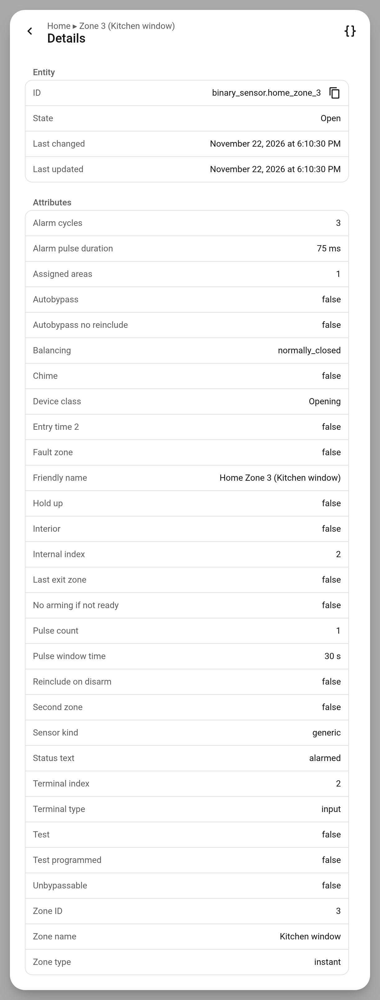

# Entities

Your panel appears in Home Assistant as one device, named as you chose at setup. Its entities are the areas, zones, scenarios and outputs you import, plus a few sensors about the panel itself. Open the device page from **Settings** → **Devices & services** → **Inim SmartLiving Alarm**.

## What you get

| Part | Entities | What you do with them |
|---|---|---|
| [The panel](#the-alarm-panel) | an alarm panel | Arm and disarm with the alarm panel card, using your scenarios |
| [Each area](#areas) | a switch, an arming mode select, three binary sensors | Arm or disarm the area; see alarm, tamper and alarm memory |
| [Each zone](#zones) | a binary sensor, a switch, two more binary sensors | See whether the zone is open; bypass it; see tamper and alarm memory |
| [Each scenario](#scenarios) | a button, a binary sensor | Run the scenario; see whether it is active |
| [Each output](#outputs) | a switch, or a light for dimmers | Switch or dim the output |
| [The panel's state](#sensors) | sensors | The event log, the active scenario, firmware and model |
| [Diagnostics](#diagnostic-and-configuration-entities) | sensors, a select, a button, a switch | The user code, the devices found, programming mode, system reports, re-reading the configuration, slow polling mode |

For example, the tile cards of an area: its arming mode, its switch and its alarm memory.

{ width="400" }
{ width="400" }

!!! note "Entity IDs"

    Entity IDs start with your panel's name: with the name *Home*, area 1's switch is `switch.home_area_1`. The tables below give the end of each ID; *N* is the area, zone or scenario number (scenario IDs count from 0). Names are shown after the panel's name, in your Home Assistant language; *(name)* is the item's name on the panel, shown when it has one. Every entity is enabled by default, except **Diagnostics level**.

## The alarm panel

| ID ends with | Name | States |
|---|---|---|
| `alarm_control_panel.…` | the panel's name | armed home, armed away, armed night, armed vacation, armed custom bypass, disarmed, triggered |

The alarm panel arms and disarms with the scenarios you mapped in the [options](options.md#initial-options). Use it with Home Assistant's alarm panel card. No code is asked.

??? note "How the state is worked out"

    *   *Triggered* while any area is in alarm.
    *   Otherwise the mode whose scenario is active on the panel, for example *Armed night*.
    *   A scenario active on the panel that is not mapped to a mode shows as *Armed custom bypass*. *Armed custom bypass* is also shown when the state of the areas matches no scenario.
    *   Without a mapped Disarm scenario, the state is unknown when no mapping matches.
    *   The state follows the scenario mapping: map as Disarm the scenario that disarms all your areas, otherwise a disarmed panel is not shown as *Disarmed*.
    *   Only the arm modes with a mapped scenario are offered. Disarming or arming without a mapped scenario fails with a message (*"No scenario is mapped to … choose one in the integration options"*).

## Areas

| ID ends with | Name | States | Device class |
|---|---|---|---|
| `switch.…_area_N` | Area N (*name*) | on when armed in any mode | – |
| `select.…_area_N_arming_mode` | Area N arming mode (*name*) | Disarmed, Armed total, Armed partial, Armed instant | – |
| `binary_sensor.…_area_N_alarm` | Area N alarm (*name*) | on while the area is in alarm | safety |
| `binary_sensor.…_area_N_tamper` | Area N tamper (*name*) | on while the area is in tamper | tamper |
| `binary_sensor.…_area_N_triggered` | Area N alarm memory (*name*) | on after an alarm, until the memory is reset | safety |

*   **The switch** arms the area when you turn it on and disarms it when you turn it off. It arms in the area's own mode set under **Area switches arm mode per area**, else in **Area switches default arm mode** (total by default).
*   **The arming mode select** arms the area in the mode you choose, or disarms it. If the panel refuses, an error says why. It is unknown while the panel reports none of the four modes.
*   **The alarm memory** stays on after an alarm until it is reset (see [Resetting the alarm memory](actions-events.md#resetting-the-alarm-memory)). Home Assistant shows the safety class as *Unsafe* while it is on.

Arming from the switch or the select checks the zones first: see [Zones not ready](actions-events.md#zones-not-ready).

??? note "Attributes of the area entities"

    | Attribute | On | Values |
    |---|---|---|
    | `area_id` | all area entities | the area's number |
    | `area_name` | all area entities | the area's name on the panel |
    | `status_text` | switch | `armed`, `disarmed`, `unknown`; `Unknown` when the panel reports no state for the area |
    | `arming_mode` | switch | `total`, `partial`, `instant`, `disarmed`, `unknown` |
    | `tamper_memory` | alarm memory | `true` when the area also has a tamper memory |
    | `exit_time` | arming mode select | time to leave after arming, for example `120 s` or `2 min` |
    | `entry_time` | arming mode select | time to disarm after a delayed zone opens |
    | `entry_time_2` | arming mode select | the second entry time, used by zones with the `entry_time_2` option, or `not used` |
    | `pre_arm_warning_time` | arming mode select | in minutes, for example `3 min` |
    | `patrol_time` | arming mode select | in minutes |
    | `timer_program` | arming mode select | the arm/disarm timer program, or `none` |
    | `reset_alarm_memory_on_arming` | arming mode select | `true` or `false` |
    | `auto_arm_partial` | arming mode select | `true` or `false` |
    | `clear_call_queue_on_disarm` | arming mode select | `true` or `false` |

    The switch shows `status_text` and `arming_mode` once the panel's state has been read. The select's delays and options are as programmed on the panel; they are not shown for panels handled with another model's layout (see [Known limitations](limitations.md)).

## Zones

Only zones that exist on the panel get entities: zones of input, input/output and double terminals. Output terminals (for example a siren) and unused terminals have none. Zones 1 to N are the zones of the panel's N terminals (50 on the SmartLiving 1050, 100 on the 10100); a double terminal *n* also has a second zone, numbered N + *n* (51 to 100 on the 1050, 101 to 200 on the 10100).

| ID ends with | Name | States | Device class |
|---|---|---|---|
| `binary_sensor.…_zone_N` | Zone N (*name*) | on while the zone is in alarm (open) | guessed, see below |
| `binary_sensor.…_zone_N_triggered` | Zone N alarm memory (*name*) | on after the zone raised an alarm, until the memory is reset | problem |
| `binary_sensor.…_zone_N_tamper` | Zone N tamper (*name*) | on while the zone is in tamper or short circuit | tamper |
| `switch.…_zone_N` | Zone N included (*name*) | on: included; off: bypassed | – |

*   **The zone sensor** is on while the zone is open or in alarm. A short circuit or tamper shows in its `status_text` and in the zone's tamper sensor.
*   **The zone switch** bypasses the zone when you turn it off, and includes it again when you turn it on.

??? note "Device class of the zone sensor"

    A wired zone does not tell the panel what detector it has, so the device class is a guess from the zone's programming:

    | Zone programming | Device class |
    |---|---|
    | shock sensor | vibration |
    | roller-blind sensor, normally open or normally closed contact, single EOL balancing | opening |
    | double EOL balancing | motion |
    | anything else | none |

    If the guess is wrong, change it in Home Assistant: open the entity's settings and pick **Show as**.

The zone sensor's attributes are the zone's programming, as read from the panel. Open the sensor, then the menu (⋮) → **Details**:

{ width="480" }

??? note "Attributes of the zone entities"

    | Attribute | On | Values |
    |---|---|---|
    | `zone_id` | all zone entities | the zone's number |
    | `zone_name` | all zone entities | the zone's name on the panel |
    | `status_text` | sensor, tamper | `clear`, `alarmed`, `short`, `tamper`; `Unknown` when the panel reports no state |
    | `test` | sensor | `true` while the zone is in test |
    | `internal_index` | sensor, switch | the position of the zone's terminal in the panel's terminal list (0-based), used by the bypass switch; not shown when the terminal is not in the list |
    | `tamper_memory` | alarm memory | `true` when the zone's terminal has a tamper memory (both zones of a double terminal share it) |
    | `zone_type` | sensor | `instant`, `delayed`, `viewable_delayed`, `route`, `24_hour`, `automation`, `arm`, `disarm`, `switch`, `arm_disarm`, `patrol`, `emergency_exit_without_call`, `emergency_exit`; a number for a value not listed here |
    | `assigned_areas` | sensor | the numbers of the zone's areas |
    | `alarm_cycles` | sensor | how many times the zone can raise an alarm, or `unlimited` |
    | `sensor_kind` | sensor | `generic`, `roller_blind`, `shock` |
    | `alarm_pulse_duration` | sensor | generic sensors only: for example `300 ms` or `20 s` (the panel counts in steps of 15 ms or of 10 s) |
    | `shock_sensitivity` | sensor | shock sensors only: 0 to 40 |
    | `pulse_window_time` | sensor | the time in which pulses are counted, for example `30 s` or `1 min` |
    | `pulse_count` | sensor | how many pulses in that time raise the alarm |
    | `balancing` | sensor | `normally_open`, `normally_closed`, `single_eol`, `double_eol`, `double_zone`, `double_zone_eol`, `personalized` |
    | `terminal_index` | sensor | the zone's terminal (0-based) |
    | `terminal_type` | sensor | `input`, `output`, `in_out`, `double`, `null`, `out_dimming`, `out_dac`, `out_analog`, `out_not_enabled` |
    | `second_zone` | sensor | `true` for the second zone of a double terminal |
    | `interior` | sensor | `true` or `false` |
    | `autobypass` | sensor | bypassed by the panel when its areas arm while it is open |
    | `unbypassable` | sensor | `true` or `false` |
    | `chime` | sensor | `true` or `false` |
    | `test_programmed` | sensor | `true` or `false` |
    | `autobypass_no_reinclude` | sensor | autobypassed and not included again when back at rest |
    | `no_arming_if_not_ready` | sensor | stops arming in every mode, when the panel refuses arming with zones not ready |
    | `entry_time_2` | sensor | uses the area's second entry time |
    | `last_exit_zone` | sensor | `true` or `false` |
    | `reinclude_on_disarm` | sensor | `true` or `false` |
    | `hold_up` | sensor | `true` or `false` |
    | `fault_zone` | sensor | `true` or `false` |

    The programming attributes (from `zone_type` on) are not shown when the panel data stored for the zone cannot be read; use **Re-read panel configuration** then. Options that only apply to wireless zones are not shown.

## Scenarios

| ID ends with | Name | States |
|---|---|---|
| `button.…_scenario_N` | Activate scenario N (*name*) | – |
| `binary_sensor.…_scenario_N_active` | Scenario N active (*name*) | on while the scenario is the active one on the panel |

*   **The button** runs the scenario. If it fails (a zone not ready, or the panel refuses), an error and a persistent notification give the reason.
*   For scenarios, *N* is the scenario number minus 1: scenario 1 is `scenario_0`. Area and zone numbers, and the `scenario` field of the `activate_scenario` action, start from 1.

??? note "Attributes of the scenario entities"

    | Attribute | On | Values |
    |---|---|---|
    | `scenario_index` | button, binary sensor | the scenario number minus 1 |
    | `scenario_name` | button, binary sensor | the scenario's name on the panel |
    | `area_actions_details` | button | what the scenario does to each area, by area number: `keep`, `total`, `partial`, `instant`, `disarm`, `unknown` |

## Sensors

| ID ends with | Name | State |
|---|---|---|
| `sensor.…_event_log` | Event log | the position of the newest event in the panel's log |
| `sensor.…_active_scenario` | Active scenario | the active scenario's name and index, for example `Night (Index 1)`, or `No scenario matches` |

*   **The event log** keeps the recent events, with the names programmed on the panel: who did it and where. It keeps its last events while the panel cannot be reached. To show it on a dashboard, see [The event log on a dashboard](actions-events.md#the-event-log-on-a-dashboard).

??? note "The event log in detail"

    The state is the position of the newest event in the panel's event log: 0 to 999, or 0 to 499 on panels that keep 500 events (the SmartLiving 505 and 515, and the 1050 on firmware 5.1). It starts again from 0 when the log wraps around, so it changes with every new event. Before the first read it is `Unknown Index`.

    | Attribute | Values |
    |---|---|
    | `event_log` | the recent events, newest first (see below) |
    | `event_log_count_current` | how many events are in `event_log` now |
    | `event_log_size_configured` | the **Number of Events to store in log** option |
    | `latest_event_description` | the newest event's description |
    | `latest_event_timestamp` | the newest event's time |

    Each event in `event_log` has:

    | Key | Values |
    |---|---|
    | `timestamp` | the event's time: the panel's clock read in Home Assistant's time zone, with daylight saving time |
    | `description` | what happened, for example `Area(s) Armed` |
    | `authorized_by` | the user code or key that did it, by name |
    | `device` | the keypad or reader, by name; `Remote` for commands from the app, the cloud, Home Assistant or the installer software |
    | `affected_areas` | the areas, by name |
    | `area` | the area, for events about one area |
    | `zone` | the zone, for zone events |
    | `scenario` | the scenario, for scenario events |
    | `authorized_id`, `device_id` | the numbers of the user code or key, and of the keypad or reader (hexadecimal) |
    | `raw_hex_data` | the event as stored by the panel |

    Keys that do not apply to an event are left out.

??? note "The active scenario in detail"

    The state is the active scenario's name followed by its index (0-based). It is `No scenario matches` when the state of the areas matches no scenario, `Unknown Scenario (Index n)` for an index without a scenario name, and `Unknown (No data)` before the panel has been read.

    | Attribute | Values |
    |---|---|
    | `active_scenario_index` | the index alone; empty when no scenario matches |
    | `raw_active_scenario_hex` | the panel's raw value |

## Diagnostic and configuration entities

These are shown in the *Diagnostic* and *Configuration* sections of the device page.

| ID ends with | Name | State |
|---|---|---|
| `button.…_reread_panel_configuration` | Re-read panel configuration | reads the panel configuration again and reloads (see [Setup](setup.md#re-reading-the-panel-configuration)) |
| `sensor.…_firmware_version` | Firmware version | the panel's firmware, for example `6.07`; created when the panel reports it |
| `sensor.…_system_type` | System type | the panel's model, for example `01050`; created when the panel reports it |
| `sensor.…_user_code` | User code | the name of the user code the PIN belongs to (never the PIN) |
| `sensor.…_peripherals` | Peripherals | how many keypads, readers, expanders and sirens are enabled |
| `binary_sensor.…_programming_mode` | Programming mode | on while the panel is in programming mode |
| `binary_sensor.…_refuses_arming_with_zones_not_ready` | Refuses arming with zones not ready | on when the installer set the panel to refuse arming with zones not ready |
| `select.…_diagnostics_level` | Diagnostics level | Redacted, Full, Full confidential; disabled by default |
| `switch.…_slow_polling_mode` | Slow polling mode | on while the panel is read every 30 seconds, so that other apps can connect to the board; SmartLAN/SI only (see [Slow polling mode](options.md#slow-polling-mode)) |

??? note "Details and attributes"

    *   **User code**: commands only work on the areas of this user code. Unknown if the PIN matches no user code: commands are refused then. Checked again whenever the integration reloads.
    *   **Peripherals**: it does not tell whether a device is answering.
    *   **Programming mode**: on while the panel is being programmed from a keypad, or reloading its configuration. Commands are not sent then. It is unavailable for panels handled with the SmartLiving 1050's layout (other models, firmware 5.0x).
    *   **Refuses arming with zones not ready**: read with the panel configuration; unknown until the configuration is read again by this version. See [Zones not ready](actions-events.md#zones-not-ready).
    *   **Slow polling mode**: stays available while the panel cannot be reached, so you can turn it off. It turns itself off at the time in `until`.
    *   **Diagnostics level**: how much the next diagnostics download shows (see [System report](system-report.md)). It goes back to *Redacted* when the integration restarts or reloads, after the readable copy of a Full report has been downloaded, and 10 minutes after a Full report's first download.

    | Attribute | On | Values |
    |---|---|---|
    | `number` | User code | the user code's number |
    | `areas` | User code | the areas it controls, by name |
    | `type` | User code | `standard`, `manager`, `master` |
    | `keypads`, `readers`, `expanders`, `sirens` | Peripherals | the names of the enabled devices |
    | `until` | Slow polling mode | when the mode turns itself off; empty while it is off or kept on until turned off |

## Outputs

!!! warning

    An output switches whatever is wired to it: a siren, a lock, a gate, heating. Switching it from Home Assistant, or from an automation, acts on the real device. Before ticking an output, check what it drives.

| ID ends with | Name | States |
|---|---|---|
| `switch.…_`*output name* | the output's name on the panel | on while the panel shows the output active |
| `light.…_`*output name* | the output's name on the panel | on or off, with brightness (dimmers) |

*   **On/off and monostable outputs** are switches. A monostable output switches itself off after its time; the switch shows it off at the next poll.
*   **Dimmers** are lights with brightness. On firmware 6 the level is read from the panel with the zone bypass (every 30 seconds by default, see [Polling](options.md#polling)) and after each change; on firmware 5.1 the panel does not report it, so the brightness is the last one set from Home Assistant.
*   Outputs without a name on the panel are called *Output n*, or *O1* to *O3* for the fixed outputs.

??? note "Which outputs are offered and ticked"

    *   **What is offered**: outputs programmed on the panel as on/off, monostable or dimmer outputs (terminal outputs and O1 to O3) that your user code may switch. Analogue outputs are not offered. A terminal output on one of the panel's first three terminal positions cannot be switched remotely (the panel reserves those numbers for O1 to O3), so it is not listed.
    *   **What is ticked for you**: only the outputs the installer marked as *home automation* outputs in the panel's programming (firmware 6; on firmware 5.1 the integration cannot read this mark, so nothing is ticked). The panel cannot tell what an output drives, so check them, and pick any other outputs yourself, in the setup or later in the options under **Areas, zones, scenarios and outputs**. The first time an existing installation shows the outputs in the options, the home automation outputs are ticked there too; after you save, your choice is kept.
    *   **Nothing is switched by itself**: no output is switched at setup, at start, at a reload or when Home Assistant restores its state.
    *   **When the panel refuses**: an output your user code may not switch, or one locked while its areas are armed, gives an error with the reason (see [When the panel refuses a command](troubleshooting.md#when-the-panel-refuses-a-command)). While the panel is in programming mode, no command is sent.

??? note "Attributes of the outputs"

    | Attribute | Values |
    |---|---|
    | `output_number` | the output's number |
    | `kind` | `on_off`, `monostable`, `dimmer` |
    | `terminal_index` | terminal outputs: the terminal (0-based) |
    | `fixed_output` | fixed outputs: 1 to 3 |
    | `monostable_time` | monostable outputs: for example `30 s` |
    | `home_automation` | `true` if the installer marked it as a home automation output; not shown on firmware 5.1 |
    | `normally_closed` | `true` or `false` |
    | `flashing` | `true` or `false` |
    | `buzzer` | `true` or `false` |
    | `keep_on_restoral` | `true` or `false` |
    | `toggle` | `true` or `false` |
    | `relay_use` | `true` or `false` |
