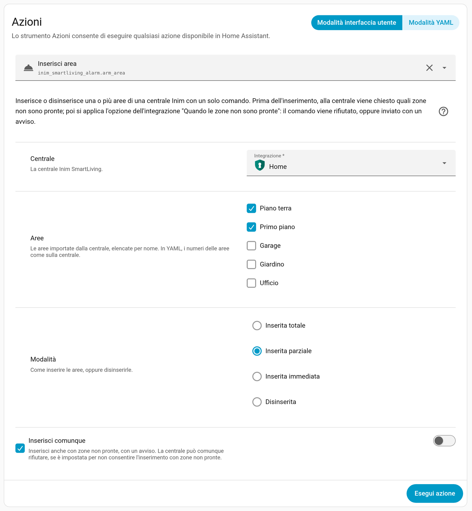
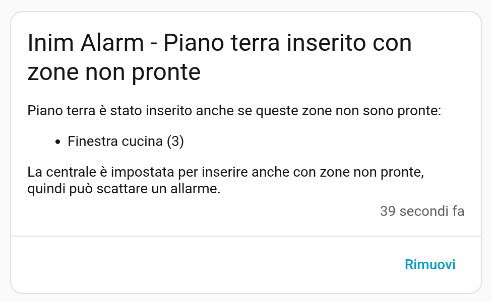

# Azioni ed eventi { #actions-and-events }

Questa pagina spiega come inserire, disinserire e attivare scenari da plance e automazioni, e come le automazioni possono reagire agli eventi dell'integrazione. Il [riferimento](#actions) alla fine elenca ogni campo.

## Da una plancia { #from-a-dashboard }

*   **L'intera centrale**: aggiungi l'entità del pannello di allarme alla scheda *Pannello degli Allarmi* di Home Assistant. I suoi pulsanti attivano gli scenari che hai associato nelle [opzioni](options.md#initial-options).
*   **Un'area**: aggiungi l'interruttore dell'area (acceso inserisce, spento disinserisce) o il suo selettore della modalità di inserimento (scegli la modalità). Una scheda riquadro con la funzione delle opzioni del selettore mostra le modalità come elenco:

    { width="400" }
    { width="400" }

*   **Uno scenario**: aggiungi il suo pulsante.
*   **Un'uscita**: aggiungi il suo interruttore o la sua luce (vedi [Uscite](entities.md#outputs)).

## Inserire aree dalle automazioni { #arming-areas-from-automations }

Usa l'azione **Inserisci area** per inserire o disinserire una o più aree di una centrale con un solo comando, così cambiano insieme. Nell'editor delle automazioni, aggiungi l'azione **Inserisci area**, scegli la centrale, seleziona le aree e scegli la modalità:

{ width="600" }

In YAML, `areas` sono i numeri delle aree come sulla centrale:

```yaml
action: inim_smartliving_alarm.arm_area
data:
  config_entry_id: your_config_entry_id
  areas: [1, 3]
  mode: partial
```

Per attivare uno scenario da un'automazione, usa **Attiva scenario** (vedi [più avanti](#action-activate-scenario)). Puoi provare qualsiasi azione da **Impostazioni** → **Strumenti** → **Azioni** (nelle versioni precedenti alla 2026.11, **Strumenti per sviluppatori** → **Azioni**).

## Reset delle memorie allarmi { #resetting-the-alarm-memory }

Dopo un allarme, la centrale conserva la memoria allarmi delle aree coinvolte finché non se ne fa il reset; i sensori *Area N memoria allarmi* la mostrano. L'azione **Reset allarme** fa il reset di ogni area della centrale che ha memorie allarmi o manomissioni:

```yaml
action: inim_smartliving_alarm.alarm_reset
target:
  entity_id: alarm_control_panel.your_panel_name
```

Puoi avviarla da uno script, da un'automazione o da un pulsante in una plancia.

## Zone non pronte { #zones-not-ready }

Prima di inserire un'area o attivare uno scenario, l'integrazione chiede alla centrale quali zone non sono pronte per l'inserimento. Tramite l'opzione **Quando le zone non sono pronte** (in **Impostazioni generali**) puoi decidere come si deve comportare l'integrazione:

*   **Rifiuta** (l'impostazione predefinita): non viene inviato nulla. Ricevi un errore che elenca le zone, per esempio *"Area 3 non è stato inserito perché queste zone non sono pronte: Finestra cucina (12)"*.
*   **Inserisci comunque e avvisa**: il comando viene inviato e una notifica elenca le zone. Possono far scattare un allarme se non vengono chiuse o escluse in tempo.

    { width="480" }

`force: true` nelle azioni **Inserisci area** e **Attiva scenario** inserisce comunque per quella chiamata, ignorando l'opzione precedente. Il disinserimento non viene mai controllato. In ogni caso, viene generato l'evento [`inim_smartliving_alarm_zones_not_ready`](#event-zones-not-ready), per esempio per annunciare le zone aperte.

??? note "Quali comandi vengono controllati, e la regola della centrale"

    *   **Controllati**: l'interruttore dell'area, il selettore della modalità di inserimento e **Inserisci area** (inserimento di un'area), e il pulsante dello scenario, il pannello di allarme e **Attiva scenario** (attivazione di uno scenario).
    *   Le zone che la centrale esclude da sola all'inserimento (zone ad autoesclusione) non vengono elencate.
    *   L'installatore può anche impostare la centrale stessa per non consentire l'inserimento con zone non pronte. L'integrazione legge questa impostazione con la configurazione della centrale e la mostra nel sensore *Rifiuta l'inserimento con zone non pronte* (e come `panel_refuses_not_ready` nell'evento). Quando è attiva, la centrale rifiuta un comando del genere anche quando inserisci comunque o usi `force`: l'integrazione lo invia lo stesso, il messaggio dice che la centrale l'ha rifiutato, e l'`action` dell'evento è `refused_by_panel`. Questa impostazione sulla centrale non può essere bypassata dall'integrazione.
    *   La regola della centrale dipende dalla programmazione di ogni zona (per esempio, le zone ritardate non bloccano l'inserimento totale, e le zone con `no_arming_if_not_ready` bloccano ogni modalità), quindi può lasciar passare zone che l'integrazione elenca. Quando l'impostazione è disattivata, la centrale inserisce qualunque cosa dica la programmazione delle zone.

## Il registro eventi in una plancia { #the-event-log-on-a-dashboard }

Una scheda Markdown mostra gli ultimi eventi del [sensore del registro eventi](entities.md#sensors). Sostituisci `sensor.home_event_log` con l'ID del tuo sensore del registro eventi:

```yaml
type: markdown
title: Eventi allarme
content: >-
  
  - {{ as_timestamp(e.timestamp) | timestamp_custom('%d/%m %H:%M') }}
  · {{ e.description_local }} · {{ e.authorized_by }} · {{ e.affected_areas }}
  
```

La cartella [Examples](https://github.com/matteoraf/ha-inim_smartliving_alarm_panel/tree/main/Examples) del repository contiene una plancia più grande, fatta per la versione 0.3: i suoi ID delle entità e alcune schede possono richiedere modifiche.

## Azioni { #actions }

Nessuna delle azioni restituisce una risposta. Se un comando non viene eseguito, l'azione non riesce, con un messaggio che dice perché (vedi [Quando la centrale rifiuta un comando](troubleshooting.md#when-the-panel-refuses-a-command)).

### Inserisci area { #action-arm-area }

`inim_smartliving_alarm.arm_area`: inserisce o disinserisce una o più aree di una centrale con un solo comando. Prima dell'inserimento, controlla le zone (vedi [Zone non pronte](#zones-not-ready)).

| Campo | Obbligatorio | Tipo e valori | Predefinito | Esempio |
|---|---|---|---|---|
| `config_entry_id` | sì | la centrale (un elenco delle tue centrali nell'editor) | – | `01J…` |
| `areas` | sì | un elenco di numeri di area, come sulla centrale; l'editor elenca le aree importate per nome | – | `[1, 3]` |
| `mode` | sì | `total`, `partial`, `instant`, `disarm` | – | `partial` |
| `force` | no | `true` inserisce anche se ci sono zone non pronte | `false` | `true` |

??? note "Quando non riesce"

    *   Con più centrali, l'editor mostra ogni numero di area con il nome che ha su ogni centrale che la importa; la centrale che scegli decide quale viene inserita.
    *   Un'area che non è importata da quella centrale (per esempio, una che hai deselezionato dopo aver scritto l'automazione) viene rifiutata con un messaggio, e non viene inviato nulla.
    *   Non riesce anche quando la centrale non viene trovata o non è caricata, quando ci sono zone non pronte e l'opzione dice *Rifiuta*, e quando la centrale rifiuta il comando.

### Attiva scenario { #action-activate-scenario }

`inim_smartliving_alarm.activate_scenario`: attiva uno scenario della centrale. Prima di attivarlo, controlla le zone (vedi [Zone non pronte](#zones-not-ready)).

| Campo | Obbligatorio | Tipo e valori | Predefinito | Esempio |
|---|---|---|---|---|
| `config_entry_id` | sì | la centrale | – | `01J…` |
| `scenario` | sì | il numero dello scenario, come sulla centrale (da 1); l'editor elenca gli scenari importati per nome | – | `2` |
| `force` | no | `true` lo attiva anche se ci sono zone non pronte | `false` | `true` |

```yaml
action: inim_smartliving_alarm.activate_scenario
data:
  config_entry_id: your_config_entry_id
  scenario: 2
```

Uno scenario che non è importato da quella centrale viene rifiutato con un messaggio. Un'attivazione non riuscita mostra anche una notifica e genera l'evento [`inim_smartliving_alarm_scenario_activation_failed`](#event-scenario-activation-failed).

### Reset allarme { #action-alarm-reset }

`inim_smartliving_alarm.alarm_reset`: fa il reset delle memorie allarmi e manomissioni di ogni area della centrale che ne ha.

| Campo | Obbligatorio | Tipo e valori | Predefinito | Esempio |
|---|---|---|---|---|
| target `entity_id` | sì | l'entità del pannello di allarme della centrale | – | `alarm_control_panel.home` |

Le entità di altre integrazioni nel target vengono ignorate. Se l'integrazione della centrale non è caricata, l'azione non riesce, con un messaggio.

### Rileggi la configurazione della centrale { #action-reread-panel-configuration }

`inim_smartliving_alarm.reread_panel_configuration`: rilegge la configurazione della centrale e ricarica l'integrazione, come il pulsante con lo stesso nome (vedi [Configurazione](setup.md#re-reading-the-panel-configuration)).

| Campo | Obbligatorio | Tipo e valori | Predefinito | Esempio |
|---|---|---|---|---|
| `config_entry_id` | sì | la centrale | – | `01J…` |

```yaml
action: inim_smartliving_alarm.reread_panel_configuration
data:
  config_entry_id: your_config_entry_id
```

Non riesce, e mantiene la configurazione salvata, quando la centrale non è raggiungibile, è in programmazione o restituisce una configurazione incompleta.

## Eventi { #events }

Le automazioni possono reagire a questi eventi con un attivatore di tipo evento.

### Zone non pronte { #event-zones-not-ready }

`inim_smartliving_alarm_zones_not_ready` viene generato ogni volta che un'area viene inserita o uno scenario viene attivato con zone non pronte, sia che il comando sia stato rifiutato, sia che sia stato inviato comunque.

| Campo | Valori |
|---|---|
| `config_entry_id` | la voce di configurazione della centrale |
| `target` | il nome dell'area, più nomi di aree separati da virgole (da **Inserisci area**), o il nome dello scenario |
| `action` | `refused` (non inviato), `armed_anyway` (inviato con un avviso), `refused_by_panel` (inviato, e la centrale l'ha rifiutato) |
| `zones` | le zone non pronte, ognuna con `zone_id` (il numero) e `zone_name` (il nome della zona sulla centrale, per esempio `Finestra cucina`, oppure `Zone 12` quando non ne ha uno) |
| `panel_refuses_not_ready` | `true` o `false`: se la centrale stessa rifiuta l'inserimento con zone non pronte; `null` prima che la configurazione sia stata riletta da questa versione |

```yaml
triggers:
  - trigger: event
    event_type: inim_smartliving_alarm_zones_not_ready
```

### Attivazione dello scenario non riuscita { #event-scenario-activation-failed }

`inim_smartliving_alarm_scenario_activation_failed` viene generato ogni volta che uno scenario non si può attivare: dal pannello di allarme, da un pulsante di scenario o da **Attiva scenario**. Uno scenario rifiutato perché ci sono zone non pronte genera entrambi gli eventi.

| Campo | Valori |
|---|---|
| `entity_unique_id` | l'ID univoco dell'entità che l'ha attivato, oppure `<entry id>_activate_scenario_action` per l'azione **Attiva scenario** |
| `entity_name` | il nome di quell'entità, oppure il titolo della voce della centrale per l'azione |
| `action` | cosa è stato chiesto, in inglese, per esempio `arm away`, `activate scenario 'Night'` (l'azione) o `activate scenario 'Night' (index 1)` (un pulsante di scenario) |
| `scenario_index` | il numero dello scenario meno 1 |
| `scenario_name` | il nome dello scenario |
| `reason` | `zones_blocked`, `no_areas_identified`, `unknown_zones_error`, `no_data_available`, `disarm_failed`, `panel_programming`, `command_failed`, `unknown`, oppure il motivo dato dalla centrale (vedi sotto), tranne `open_zones` e `refused`, che danno `zones_blocked` o `unknown_zones_error` |
| `panel_result` | il motivo della centrale quando ha rifiutato il comando (compresi `open_zones` e `refused`), `unknown` per un motivo che l'integrazione non conosce, oppure `null` quando la centrale non l'ha rifiutato |
| `blocking_zones` | le zone che l'hanno bloccato, ognuna con `zone_id`, `zone_name`, `status` (`not_ready`, `alarmed`, `short` o `tamper`) e `areas` (per nome) |
| `message` | una descrizione, sempre in inglese, qualunque sia la lingua di Home Assistant |

I motivi della centrale sono `invalid_code`, `open_zones`, `code_not_enabled`, `already_in_state`, `slot_out_of_range`, `slot_not_connected`, `null_terminal`, `cannot_be_bypassed`, `no_areas`, `double_zone_error`, `output_not_enabled`, `areas_armed` e `refused`; cosa significa ognuno è in [Risoluzione dei problemi](troubleshooting.md#when-the-panel-refuses-a-command).

## Comandare le uscite { #switching-outputs }

Vedi [Uscite](entities.md#outputs).
