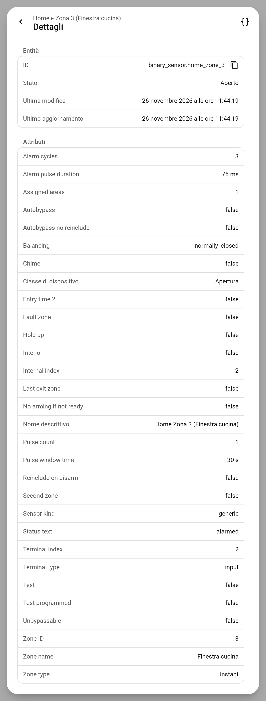
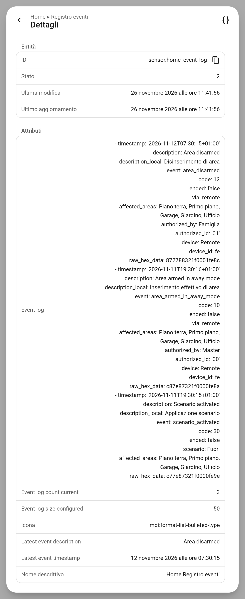

# Entità { #entities }

La tua centrale compare in Home Assistant come un dispositivo, con il nome che hai scelto durante la configurazione. Le sue entità sono le aree, le zone, gli scenari e le uscite che importi, più alcuni sensori sulla centrale stessa. Apri la pagina del dispositivo da **Impostazioni** → **Dispositivi e servizi** → **Inim SmartLiving Alarm**.

## Cosa ottieni { #what-you-get }

| Parte | Entità | Cosa ci fai |
|---|---|---|
| [La centrale](#the-alarm-panel) | un pannello di allarme | Inserire e disinserire con la scheda *Pannello degli Allarmi*, usando i tuoi scenari |
| [Ogni area](#areas) | un interruttore, un selettore della modalità di inserimento, tre sensori binari | Inserire o disinserire l'area; vedere allarme, manomissione e memoria allarmi |
| [Ogni zona](#zones) | un sensore binario, un interruttore, altri due sensori binari | Vedere se la zona è aperta; escluderla; vedere manomissione e memoria allarmi |
| [Ogni scenario](#scenarios) | un pulsante, un sensore binario | Attivare lo scenario; vedere se è attivo |
| [Ogni uscita](#outputs) | un interruttore, o una luce per i dimmer | Accendere e spegnere l'uscita, o regolarla |
| [Il termostato di ogni tastiera](#thermostats) | un'entità clima, un sensore di temperatura | Impostare la temperatura, il riscaldamento o il raffrescamento, il programma; vedere la temperatura ambiente |
| [Lo stato della centrale](#sensors) | sensori | Il registro eventi, lo scenario attivo, firmware e modello |
| [Diagnostica](#diagnostic-and-configuration-entities) | sensori, sensori binari, un selettore, un pulsante, un interruttore | Il codice utente, i dispositivi trovati, la modalità programmazione, i report di sistema, la rilettura della configurazione, la modalità aggiornamento lento |

Per esempio, le schede riquadro di un'area: la sua modalità di inserimento, il suo interruttore e la sua memoria allarmi.

{ width="400" }
{ width="400" }

!!! note "ID delle entità"

    Gli ID delle entità iniziano con il nome della tua centrale: con il nome *Home*, l'interruttore dell'area 1 è `switch.home_area_1`. Le tabelle qui sotto danno la parte finale di ogni ID; *N* è il numero dell'area, della zona o dello scenario (gli ID degli scenari contano da 0). I nomi sono mostrati dopo il nome della centrale, nella lingua di Home Assistant; *(nome)* è il nome della voce sulla centrale, mostrato quando ne ha uno. Tutte le entità sono attive per impostazione predefinita, tranne **Livello diagnostica**.

## Il pannello di allarme { #the-alarm-panel }

| L'ID finisce con | Nome | Stati |
|---|---|---|
| `alarm_control_panel.…` | il nome della centrale | attivo in casa, attivo fuori casa, attivo notte, attivo in vacanza, attivo con esclusione personalizzata, disattivo, innescato |

Il pannello di allarme inserisce e disinserisce con gli scenari che hai associato nelle [opzioni](options.md#initial-options). Usalo con la scheda *Pannello degli Allarmi* di Home Assistant. Non viene chiesto nessun codice.

??? note "Come viene ricavato lo stato"

    *   *Innescato* mentre una qualsiasi area è in allarme.
    *   Altrimenti la modalità il cui scenario è attivo sulla centrale, per esempio *Attivo notte*.
    *   Uno scenario attivo sulla centrale che non è associato a una modalità compare come *Attivo con esclusione personalizzata*. *Attivo con esclusione personalizzata* compare anche quando lo stato delle aree non corrisponde a nessuno scenario.
    *   Senza uno scenario di disinserimento associato, lo stato è sconosciuto quando nessuna associazione corrisponde.
    *   Lo stato segue l'associazione degli scenari: associa al disinserimento lo scenario che disinserisce tutte le tue aree, altrimenti una centrale disinserita non compare come *Disattivo*.
    *   Vengono proposte solo le modalità di inserimento con uno scenario associato. Disinserire o inserire senza uno scenario associato non riesce, con un messaggio (*"Nessuno scenario è associato a … sceglilo nelle opzioni dell'integrazione"*).

## Aree { #areas }

| L'ID finisce con | Nome | Stati | Classe del dispositivo |
|---|---|---|---|
| `switch.…_area_N` | Area N (*nome*) | acceso quando l'area è inserita in una qualsiasi modalità | – |
| `select.…_area_N_arming_mode` | Area N modalità di inserimento (*nome*) | Disinserita, Inserita totale, Inserita parziale, Inserita immediata | – |
| `binary_sensor.…_area_N_alarm` | Area N allarme (*nome*) | acceso mentre l'area è in allarme | sicurezza |
| `binary_sensor.…_area_N_tamper` | Area N manomissione (*nome*) | acceso mentre l'area è in manomissione | manomissione |
| `binary_sensor.…_area_N_triggered` | Area N memoria allarmi (*nome*) | acceso dopo un allarme, finché non si fa il reset della memoria | sicurezza |

*   **L'interruttore** inserisce l'area quando lo accendi e la disinserisce quando lo spegni. Inserisce nella modalità dell'area impostata in **Modalità di inserimento per area**, altrimenti in **Modalità di inserimento predefinita delle aree** (totale per impostazione predefinita).
*   **Il selettore della modalità di inserimento** inserisce l'area nella modalità che scegli, oppure la disinserisce. Se la centrale rifiuta, un errore dice perché. È sconosciuto mentre la centrale non riporta nessuna delle quattro modalità.
*   **La memoria allarmi** resta accesa dopo un allarme finché non si fa il reset (vedi [Reset delle memorie allarmi](actions-events.md#resetting-the-alarm-memory)). Mentre è accesa, Home Assistant mostra la classe sicurezza come *Non Sicuro*.

L'inserimento dall'interruttore o dal selettore controlla prima le zone: vedi [Zone non pronte](actions-events.md#zones-not-ready).

??? note "Attributi delle entità delle aree"

    | Attributo | Su | Valori |
    |---|---|---|
    | `area_id` | tutte le entità dell'area | il numero dell'area |
    | `area_name` | tutte le entità dell'area | il nome dell'area sulla centrale |
    | `status_text` | interruttore | `armed`, `disarmed`, `unknown`; `Unknown` quando la centrale non riporta nessuno stato per l'area |
    | `arming_mode` | interruttore | `total`, `partial`, `instant`, `disarmed`, `unknown` |
    | `tamper_memory` | memoria allarmi | `true` quando l'area ha anche una memoria manomissioni |
    | `exit_time` | selettore della modalità di inserimento | il tempo per uscire dopo l'inserimento, per esempio `120 s` o `2 min` |
    | `entry_time` | selettore della modalità di inserimento | il tempo per disinserire dopo l'apertura di una zona ritardata |
    | `entry_time_2` | selettore della modalità di inserimento | il secondo tempo di ingresso, usato dalle zone con l'opzione `entry_time_2`, oppure `not used` |
    | `pre_arm_warning_time` | selettore della modalità di inserimento | in minuti, per esempio `3 min` |
    | `patrol_time` | selettore della modalità di inserimento | in minuti |
    | `timer_program` | selettore della modalità di inserimento | il programma orario di inserimento e disinserimento, oppure `none` |
    | `reset_alarm_memory_on_arming` | selettore della modalità di inserimento | `true` o `false` |
    | `auto_arm_partial` | selettore della modalità di inserimento | `true` o `false` |
    | `clear_call_queue_on_disarm` | selettore della modalità di inserimento | `true` o `false` |

    L'interruttore mostra `status_text` e `arming_mode` dopo che lo stato della centrale è stato letto. I tempi e le opzioni del selettore sono quelli programmati sulla centrale; non sono mostrati per le centrali gestite con la mappa di un altro modello (vedi [Limitazioni note](limitations.md)).

## Zone { #zones }

Ricevono entità solo le zone che esistono sulla centrale: le zone dei terminali di ingresso, di ingresso/uscita e doppi. I terminali di uscita (per esempio una sirena) e i terminali inutilizzati non ne hanno. Le zone da 1 a N sono le zone degli N terminali della centrale (50 sulla SmartLiving 1050, 100 sulla 10100); un terminale doppio *n* ha anche una seconda zona, con il numero N + *n* (da 51 a 100 sulla 1050, da 101 a 200 sulla 10100).

| L'ID finisce con | Nome | Stati | Classe del dispositivo |
|---|---|---|---|
| `binary_sensor.…_zone_N` | Zona N (*nome*) | acceso mentre la zona è in allarme (aperta) | ricavata, vedi sotto |
| `binary_sensor.…_zone_N_triggered` | Zona N memoria allarmi (*nome*) | acceso dopo che la zona ha generato un allarme, finché non si fa il reset della memoria | problema |
| `binary_sensor.…_zone_N_tamper` | Zona N manomissione (*nome*) | acceso mentre la zona è in manomissione o in cortocircuito | manomissione |
| `switch.…_zone_N` | Zona N inclusa (*nome*) | acceso: inclusa; spento: esclusa | – |

*   **Il sensore della zona** è acceso mentre la zona è aperta o in allarme. Un cortocircuito o una manomissione compaiono nel suo `status_text` e nel sensore di manomissione della zona.
*   **L'interruttore della zona** esclude la zona quando lo spegni, e la include di nuovo quando lo accendi.

??? note "Classe del dispositivo del sensore della zona"

    Una zona cablata non dice alla centrale che rilevatore ha, quindi la classe del dispositivo è ricavata dalla programmazione della zona:

    | Programmazione della zona | Classe del dispositivo |
    |---|---|
    | sensore inerziale | vibrazione |
    | sensore tapparella, contatto normalmente aperto o normalmente chiuso, bilanciamento singolo | apertura |
    | bilanciamento doppio | movimento |
    | tutto il resto | nessuna |

    Se la classe è sbagliata, cambiala in Home Assistant: apri le impostazioni dell'entità e scegli **Mostra come**.

Gli attributi del sensore della zona sono la programmazione della zona, come letta dalla centrale. Apri il sensore, poi il menu (⋮) → **Dettagli**:

{ width="480" }

??? note "Attributi delle entità delle zone"

    | Attributo | Su | Valori |
    |---|---|---|
    | `zone_id` | tutte le entità della zona | il numero della zona |
    | `zone_name` | tutte le entità della zona | il nome della zona sulla centrale |
    | `status_text` | sensore, manomissione | `clear`, `alarmed`, `short`, `tamper`; `Unknown` quando la centrale non riporta nessuno stato |
    | `test` | sensore | `true` mentre la zona è in test |
    | `internal_index` | sensore, interruttore | la posizione del terminale della zona nell'elenco dei terminali della centrale (da 0), usata dall'interruttore di esclusione; non mostrato quando il terminale non è nell'elenco |
    | `tamper_memory` | memoria allarmi | `true` quando il terminale della zona ha una memoria manomissioni (le due zone di un terminale doppio la condividono) |
    | `zone_type` | sensore | `instant`, `delayed`, `viewable_delayed`, `route`, `24_hour`, `automation`, `arm`, `disarm`, `switch`, `arm_disarm`, `patrol`, `emergency_exit_without_call`, `emergency_exit`; un numero per un valore non elencato qui |
    | `assigned_areas` | sensore | i numeri delle aree della zona |
    | `alarm_cycles` | sensore | quante volte la zona può generare un allarme, oppure `unlimited` |
    | `sensor_kind` | sensore | `generic`, `roller_blind`, `shock` |
    | `alarm_pulse_duration` | sensore | solo sensori generici: per esempio `300 ms` o `20 s` (la centrale conta a passi di 15 ms o di 10 s) |
    | `shock_sensitivity` | sensore | solo sensori inerziali: da 0 a 40 |
    | `pulse_window_time` | sensore | il tempo in cui vengono contati gli impulsi, per esempio `30 s` o `1 min` |
    | `pulse_count` | sensore | quanti impulsi in quel tempo generano l'allarme |
    | `balancing` | sensore | `normally_open`, `normally_closed`, `single_eol`, `double_eol`, `double_zone`, `double_zone_eol`, `personalized` |
    | `terminal_index` | sensore | il terminale della zona (da 0) |
    | `terminal_type` | sensore | `input`, `output`, `in_out`, `double`, `null`, `out_dimming`, `out_dac`, `out_analog`, `out_not_enabled` |
    | `second_zone` | sensore | `true` per la seconda zona di un terminale doppio |
    | `interior` | sensore | `true` o `false` |
    | `autobypass` | sensore | esclusa dalla centrale quando le sue aree si inseriscono mentre è aperta |
    | `unbypassable` | sensore | `true` o `false` |
    | `chime` | sensore | `true` o `false` |
    | `test_programmed` | sensore | `true` o `false` |
    | `autobypass_no_reinclude` | sensore | esclusa automaticamente e non inclusa di nuovo quando torna a riposo |
    | `no_arming_if_not_ready` | sensore | blocca l'inserimento in ogni modalità, quando la centrale rifiuta l'inserimento con zone non pronte |
    | `entry_time_2` | sensore | usa il secondo tempo di ingresso dell'area |
    | `last_exit_zone` | sensore | `true` o `false` |
    | `reinclude_on_disarm` | sensore | `true` o `false` |
    | `hold_up` | sensore | `true` o `false` |
    | `fault_zone` | sensore | `true` o `false` |

    Gli attributi di programmazione (da `zone_type` in poi) non sono mostrati quando i dati della centrale salvati per la zona non si possono leggere; in quel caso usa **Rileggi la configurazione della centrale**. Le opzioni che valgono solo per le zone radio non sono mostrate.

## Scenari { #scenarios }

| L'ID finisce con | Nome | Stati |
|---|---|---|
| `button.…_scenario_N` | Attiva scenario N (*nome*) | – |
| `binary_sensor.…_scenario_N_active` | Scenario N attivo (*nome*) | acceso mentre lo scenario è quello attivo sulla centrale |

*   **Il pulsante** attiva lo scenario. Se non riesce (una zona non pronta, o la centrale rifiuta), un errore e una notifica persistente danno il motivo.
*   Per gli scenari, *N* è il numero dello scenario meno 1: lo scenario 1 è `scenario_0`. I numeri delle aree e delle zone, e il campo `scenario` dell'azione `activate_scenario`, partono da 1.

??? note "Attributi delle entità degli scenari"

    | Attributo | Su | Valori |
    |---|---|---|
    | `scenario_index` | pulsante, sensore binario | il numero dello scenario meno 1 |
    | `scenario_name` | pulsante, sensore binario | il nome dello scenario sulla centrale |
    | `area_actions_details` | pulsante | cosa fa lo scenario a ogni area, per numero di area: `keep`, `total`, `partial`, `instant`, `disarm`, `unknown` |

## Sensori { #sensors }

| L'ID finisce con | Nome | Stato |
|---|---|---|
| `sensor.…_event_log` | Registro eventi | la posizione dell'evento più recente nel registro della centrale |
| `sensor.…_active_scenario` | Scenario attivo | il nome e l'indice dello scenario attivo, per esempio `Night (Index 1)`, oppure `No scenario matches` |

*   **Il registro eventi** conserva gli eventi recenti, con i nomi programmati sulla centrale: chi è stato e dove. Conserva i suoi ultimi eventi mentre la centrale non è raggiungibile. Per mostrarlo in una plancia, vedi [Il registro eventi in una plancia](actions-events.md#the-event-log-on-a-dashboard).

Gli eventi e le loro chiavi sono negli attributi del sensore: apri il sensore, poi il menu (⋮) → **Dettagli**:

{ width="480" }

??? note "Il registro eventi nel dettaglio"

    Lo stato è la posizione dell'evento più recente nel registro eventi della centrale: da 0 a 999, oppure da 0 a 499 sulle centrali che conservano 500 eventi (le SmartLiving 505 e 515, e la 1050 con firmware 5.1). Ricomincia da 0 quando il registro si riempie e riparte dall'inizio, quindi cambia a ogni nuovo evento. Prima della prima lettura è `Unknown Index`.

    | Attributo | Valori |
    |---|---|
    | `event_log` | gli eventi recenti, dal più recente (vedi sotto) |
    | `event_log_count_current` | quanti eventi ci sono ora in `event_log` |
    | `event_log_size_configured` | l'opzione **Numero di eventi da conservare nel registro** |
    | `latest_event_description` | la descrizione dell'evento più recente, in inglese |
    | `latest_event_timestamp` | l'ora dell'evento più recente |

    L'elenco `event_log` non viene conservato nello storico di Home Assistant (il recorder): può essere più grande di quanto il recorder conserva, e dopo un riavvio l'elenco viene riletto dalla centrale, che ha il proprio registro. Plance, modelli e automazioni lo leggono come al solito; gli altri attributi vengono conservati nello storico.

    Ogni evento in `event_log` ha:

    | Chiave | Valori |
    |---|---|
    | `timestamp` | l'ora dell'evento: l'orologio della centrale letto nel fuso orario di Home Assistant, con l'ora legale |
    | `description` | cosa è successo, in inglese, il nome che la centrale dà all'evento, per esempio `Area armed in away mode`; quando la centrale registra la fine di qualcosa viene aggiunto `(ended)`, per esempio `Zone alarm (ended)` |
    | `description_local` | lo stesso nella lingua di Home Assistant (inglese o italiano), per esempio `Inserimento effettivo di area` o `Allarme zona (ripristino)` |
    | `event` | la chiave dell'evento, uguale in ogni lingua: usala nelle automazioni, per esempio `area_armed_in_away_mode`, `zone_alarm`; `detector_dusty` per un guasto di un'uscita che l'installatore ha impostato per segnalare un rilevatore di fumo sporco; `free_event` e `unknown` per gli eventi senza nome |
    | `code` | il codice dell'evento nella numerazione del firmware 6 (da 0 a 113), anche sulle centrali con firmware 5.1; un codice a cui il firmware 6 non dà un nome può essere da 114 a 127; vuoto (`null`) per gli eventi liberi che ha solo il firmware 5.1 |
    | `ended` | `true` quando la centrale registra la fine di qualcosa (un allarme, un'esclusione, un guasto); `false` quando inizia o avviene |
    | `via` | come è avvenuto, per gli eventi che lo indicano: `keypad_code`, `reader_key`, `remote` (l'app, il cloud, Home Assistant o il software dell'installatore), `command_zone`, `patrol_time`, `timer`, `keypad_shortcut`, `telephone`, `user_code` (una zona esclusa da un utente), `automatic` (una zona esclusa dalla centrale) |
    | `authorized_by` | il codice utente o la chiave che l'ha fatto, per nome |
    | `device` | la tastiera o il lettore, per nome; `Remote` per i comandi dall'app, dal cloud, da Home Assistant o dal software dell'installatore; `From telephone`; `Location N` quando la centrale registra un luogo che questo evento non usa |
    | `affected_areas` | le aree, per nome; `None` quando non riguarda nessuna area |
    | `zone` | la zona, per gli eventi di zona |
    | `scenario` | lo scenario, per gli eventi di scenario |
    | `keypad`, `reader`, `expander`, `siren`, `timer` | il dispositivo di cui parla l'evento (una manomissione, una scomparsa, un timer), per nome |
    | `phone_number` | il numero di telefono chiamato, con il nome che ha sulla centrale (solo il nome, mai il numero), per esempio `Cloud`; `Number 12` quando non ne ha uno |
    | `emergency_key`, `programmable_event` | l'oggetto di cui parla l'evento, per numero (*Emergency key 1*, *Programmable event 2*): i loro nomi non vengono letti dalla centrale |
    | `number` | il numero di un evento di panico o periodico, come lo mostra la centrale, per esempio `001` |
    | `authorized_id`, `device_id` | i numeri del codice utente o della chiave, e della tastiera o del lettore (esadecimali) |
    | `raw_hex_data` | l'evento come salvato dalla centrale |

    Le chiavi che non valgono per un evento non sono presenti. *Remote*, *From telephone* e i valori di `via` sono parole dell'integrazione: la centrale lascia vuoti quei campi.

    La centrale registra un inserimento come la fine dell'ultimo disinserimento e un disinserimento come la fine dell'ultimo inserimento: ogni disinserimento aggiunge *Area armed in away mode (ended)* (o *in stay mode*) accanto ad *Area disarmed*, e ogni inserimento aggiunge *Area disarmed (ended)*.

??? note "Lo scenario attivo nel dettaglio"

    Lo stato è il nome dello scenario attivo seguito dal suo indice (da 0). È `No scenario matches` quando lo stato delle aree non corrisponde a nessuno scenario, `Scenario N (Index n)` per uno scenario senza nome, `Unknown Scenario (Index n)` per un indice che la centrale non ha, e `Unknown (No data)` prima che la centrale sia stata letta.

    | Attributo | Valori |
    |---|---|
    | `active_scenario_index` | solo l'indice; vuoto quando nessuno scenario corrisponde |
    | `raw_active_scenario_hex` | il valore grezzo della centrale |

## Entità di diagnostica e di configurazione { #diagnostic-and-configuration-entities }

Compaiono nelle sezioni *Diagnostica* e *Configurazione* della pagina del dispositivo.

| L'ID finisce con | Nome | Stato |
|---|---|---|
| `button.…_reread_panel_configuration` | Rileggi la configurazione della centrale | rilegge la configurazione della centrale e ricarica l'integrazione (vedi [Configurazione](setup.md#re-reading-the-panel-configuration)) |
| `sensor.…_firmware_version` | Versione firmware | il firmware della centrale, per esempio `6.07`; creato quando la centrale lo riporta |
| `sensor.…_system_type` | Tipo di centrale | il modello della centrale, per esempio `01050`; creato quando la centrale lo riporta |
| `sensor.…_user_code` | Codice utente | il nome del codice utente a cui appartiene il PIN (mai il PIN) |
| `sensor.…_peripherals` | Periferiche | quante tastiere, lettori, espansioni e sirene sono abilitati |
| `binary_sensor.…_programming_mode` | Modalità programmazione | acceso mentre la centrale è in programmazione |
| `binary_sensor.…_refuses_arming_with_zones_not_ready` | Rifiuta l'inserimento con zone non pronte | acceso quando l'installatore ha impostato la centrale per rifiutare l'inserimento con zone non pronte |
| `select.…_diagnostics_level` | Livello diagnostica | Oscurato, Completo, Completo riservato; disattivata per impostazione predefinita |
| `switch.…_slow_polling_mode` | Modalità aggiornamento lento | acceso mentre la centrale viene letta ogni 30 secondi per impostazione predefinita (**Intervallo di lettura in modalità aggiornamento lento**), così che le altre app possano collegarsi alla scheda; solo SmartLAN/SI (vedi [Modalità aggiornamento lento](options.md#slow-polling-mode)) |

??? note "Dettagli e attributi"

    *   **Codice utente**: i comandi funzionano solo sulle aree di questo codice utente. Sconosciuto se il PIN non corrisponde a nessun codice utente: in quel caso i comandi vengono rifiutati. Viene verificato di nuovo ogni volta che viene ricaricata l'integrazione.
    *   **Periferiche**: non dice se un dispositivo risponde.
    *   **Modalità programmazione**: acceso mentre la centrale viene programmata da una tastiera, o mentre ricarica la sua configurazione. In quel momento i comandi non vengono inviati. Disponibile solo per le centrali con firmware uguale o superiore al 5.1.
    *   **Rifiuta l'inserimento con zone non pronte**: letto con la configurazione della centrale; sconosciuto finché la configurazione non viene riletta da questa versione. Vedi [Zone non pronte](actions-events.md#zones-not-ready).
    *   **Modalità aggiornamento lento**: resta disponibile mentre la centrale non è raggiungibile, così puoi spegnerla. Si spegne da sola all'ora indicata in `until`.
    *   **Livello diagnostica**: quanto mostra il prossimo download della diagnostica (vedi [Report di sistema](system-report.md)). Torna a *Oscurato* quando l'integrazione si riavvia o si ricarica, dopo che è stata scaricata la copia leggibile di un report Completo, e 10 minuti dopo il primo download di un report Completo.

    | Attributo | Su | Valori |
    |---|---|---|
    | `number` | Codice utente | il numero del codice utente |
    | `areas` | Codice utente | le aree che comanda, per nome |
    | `type` | Codice utente | `standard`, `manager`, `master` |
    | `keypads`, `readers`, `expanders`, `sirens` | Periferiche | i nomi dei dispositivi abilitati |
    | `until` | Modalità aggiornamento lento | quando la modalità si spegne da sola; vuoto mentre è spenta o tenuta accesa finché non la spegni |

## Uscite { #outputs }

!!! warning

    Un'uscita comanda qualunque cosa vi sia collegata: una sirena, una serratura, un cancello, il riscaldamento. Comandarla da Home Assistant, o da un'automazione, agisce sul dispositivo reale. Prima di selezionare un'uscita, controlla cosa comanda.

| L'ID finisce con | Nome | Stati |
|---|---|---|
| `switch.…_`*nome dell'uscita* | il nome dell'uscita sulla centrale | acceso mentre la centrale mostra l'uscita attiva |
| `light.…_`*nome dell'uscita* | il nome dell'uscita sulla centrale | acceso o spento, con la luminosità (dimmer) |

*   **Le uscite on/off e monostabili** sono interruttori. Un'uscita monostabile si spegne da sola dopo il suo tempo; l'interruttore la mostra spenta alla lettura successiva.
*   **I dimmer** sono luci con luminosità. Con il firmware 6 il livello viene letto dalla centrale insieme all'esclusione delle zone (ogni 30 secondi per impostazione predefinita, vedi [Aggiornamento](options.md#polling)) e dopo ogni modifica; con il firmware 5.1 la centrale non lo riporta, quindi la luminosità è l'ultima impostata da Home Assistant.
*   Le uscite senza nome sulla centrale si chiamano *Uscita n*, oppure da *O1* a *O3* per le uscite fisse.

??? note "Quali uscite vengono proposte e selezionate"

    *   **Cosa viene proposto**: le uscite programmate sulla centrale come uscite on/off, monostabili o dimmer (uscite su terminale e da O1 a O3) che il tuo codice utente può comandare. Le uscite analogiche non vengono proposte. Un'uscita su terminale in una delle prime tre posizioni di terminale della centrale non si può comandare a distanza (la centrale riserva quei numeri a O1-O3), quindi non viene elencata.
    *   **Cosa viene selezionato per te**: solo le uscite che l'installatore ha contrassegnato come *domotiche* nella programmazione della centrale (firmware 6; con il firmware 5.1 l'integrazione non può leggere questo contrassegno, quindi non viene selezionato nulla). La centrale non può sapere cosa comanda un'uscita, quindi controllale, e scegli tu le altre uscite, durante la configurazione o in seguito nelle opzioni in **Aree, zone, scenari, uscite e termostati**. La prima volta che un'installazione esistente mostra le uscite nelle opzioni, vi sono selezionate anche le uscite domotiche; dopo che hai salvato, la tua scelta viene mantenuta.
    *   **Nulla viene comandato da solo**: nessuna uscita viene comandata durante la configurazione, all'avvio, a una ricarica o quando Home Assistant ripristina il suo stato.
    *   **Quando la centrale rifiuta**: un'uscita che il tuo codice utente non può comandare, o una bloccata mentre le sue aree sono inserite, dà un errore con il motivo (vedi [Quando la centrale rifiuta un comando](troubleshooting.md#when-the-panel-refuses-a-command)). Mentre la centrale è in programmazione, non viene inviato nessun comando.

??? note "Attributi delle uscite"

    | Attributo | Valori |
    |---|---|
    | `output_number` | il numero dell'uscita |
    | `kind` | `on_off`, `monostable`, `dimmer` |
    | `terminal_index` | uscite su terminale: il terminale (da 0) |
    | `fixed_output` | uscite fisse: da 1 a 3 |
    | `monostable_time` | uscite monostabili: per esempio `30 s` |
    | `home_automation` | `true` se l'installatore l'ha contrassegnata come uscita domotica; non mostrato con il firmware 5.1 |
    | `normally_closed` | `true` o `false` |
    | `flashing` | `true` o `false` |
    | `buzzer` | `true` o `false` |
    | `keep_on_restoral` | `true` o `false` |
    | `toggle` | `true` o `false` |
    | `relay_use` | `true` o `false` |

## Termostati { #thermostats }

Una tastiera con sensore di temperatura misura la temperatura ambiente, e la centrale può usarla come termostato: accende il riscaldamento o il raffrescamento tramite le uscite e le notifiche programmate sul suo evento *Termostato su tastiera*. Ogni tastiera di cui importi il termostato riceve:

| L'ID finisce con | Nome | Stati |
|---|---|---|
| `climate.…_thermostat_N` | Termostato N (*nome della tastiera*) | spento, riscaldamento, freddo |
| `sensor.…_keypad_N_temperature` | Temperatura tastiera N (*nome della tastiera*) | la temperatura ambiente, in °C |

La temperatura ambiente della tastiera è anche la temperatura attuale del termostato; il sensore ne conserva lo storico come statistica.

| Sulla centrale | Modalità | Preimpostazione | Temperatura obiettivo |
|---|---|---|---|
| Spento | spento | – | il valore manuale, conservato per quando viene acceso |
| Manuale | riscaldamento (inverno) o freddo (estate) | *Manuale* | il valore manuale |
| Programma giornaliero | riscaldamento o freddo | *Programma giornaliero* | il valore di quest'ora del programma giornaliero |
| Programma settimanale | riscaldamento o freddo | *Programma settimanale* | il valore di quest'ora del programma settimanale |
| Antigelo | riscaldamento | *Antigelo* | 5,0 °C |

*   **Riscaldamento o freddo** è la stagione della centrale: in inverno riscalda sotto l'obiettivo, in estate raffresca sopra. L'antigelo riscalda sempre. Con il firmware 6 la scheda mostra se il termostato sta riscaldando o raffrescando in quel momento; il firmware 5.1 non lo riporta.
*   **Cosa fa una modifica sulla centrale**:

    *   **Riscaldamento** o **freddo** imposta la stagione. Da spento, riporta anche il termostato alla modalità in cui era l'ultima volta (manuale, programma giornaliero o settimanale; manuale la prima volta). In antigelo, **riscaldamento** non cambia nulla (riscalda già), e **freddo** esce dall'antigelo verso la modalità in cui era l'ultima volta, in estate.
    *   **Spento** imposta la modalità spento. Una **preimpostazione** imposta quella modalità.
    *   **Una temperatura obiettivo** imposta il valore manuale, da 10,0 a 35,5 °C. In un programma o in antigelo il termostato passa anche a manuale. Mentre è spento, resta spento con il nuovo valore conservato per dopo.
*   **La centrale agisce al suo controllo successivo di quella tastiera**, che può richiedere qualche minuto: il riscaldamento o il raffrescamento si avvia o si ferma allora, non subito.
*   **I programmi non vengono cambiati**: impostali dalla tastiera. L'obiettivo mostrato per un programma segue l'orologio di Home Assistant; la centrale segue il suo, quindi i due possono differire per qualche minuto se gli orologi non coincidono.
*   **Ogni modifica viene scritta nella memoria della centrale.** Evita automazioni che cambiano la temperatura obiettivo ogni pochi minuti.

!!! warning

    Accendere un termostato genera l'evento *Termostato su tastiera* della centrale quando richiede riscaldamento o raffrescamento. Le uscite, le chiamate o i messaggi programmati su quell'evento (dal tuo installatore, per esempio il relè di una caldaia) lo seguono. Prima di usare un termostato per la prima volta, controlla cosa fa la centrale con il suo evento.

??? note "Quali tastiere ricevono un termostato"

    *   **Cosa viene proposto**: le tastiere abilitate.
    *   **Cosa viene selezionato per te**: le tastiere che riportano una temperatura ambiente quando la centrale viene aggiunta. Un'installazione di una versione precedente controlla le sue tastiere una volta, in background dopo il primo avvio, e aggiunge allora i loro termostati.
    *   **Ogni tastiera con sensore** riceve così un termostato, anche quella di cui non usi il termostato. Deselezionala nelle opzioni in **Aree, zone, scenari, uscite e termostati** per rimuoverne le entità.
    *   Una tastiera che smette di rispondere mantiene il suo termostato; la sua temperatura è sconosciuta finché non risponde di nuovo, e nel frattempo viene interrogata meno spesso.
    *   Provato su una SmartLiving 1050 con firmware 6.07 tramite SmartLAN/SI, dove queste modifiche non riavviano la centrale. Non provato su una scheda SmartLAN/G, né con il firmware 5.1.
