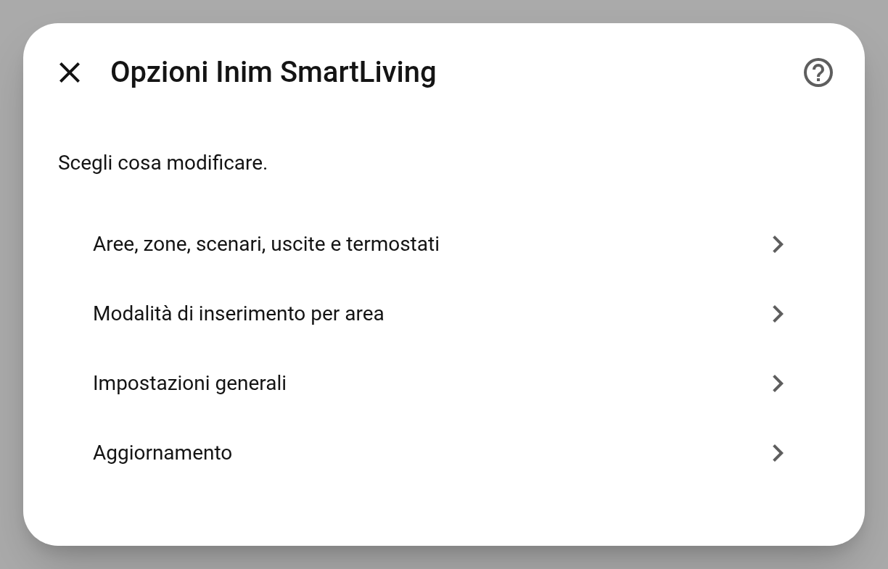
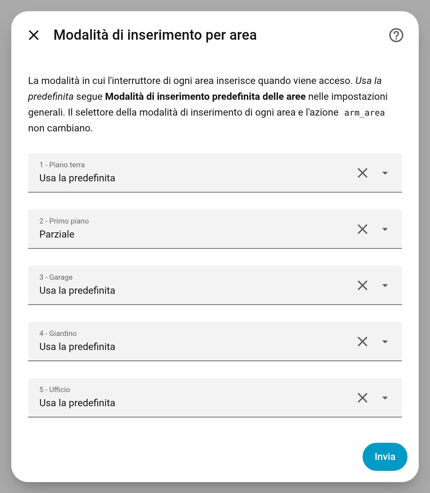
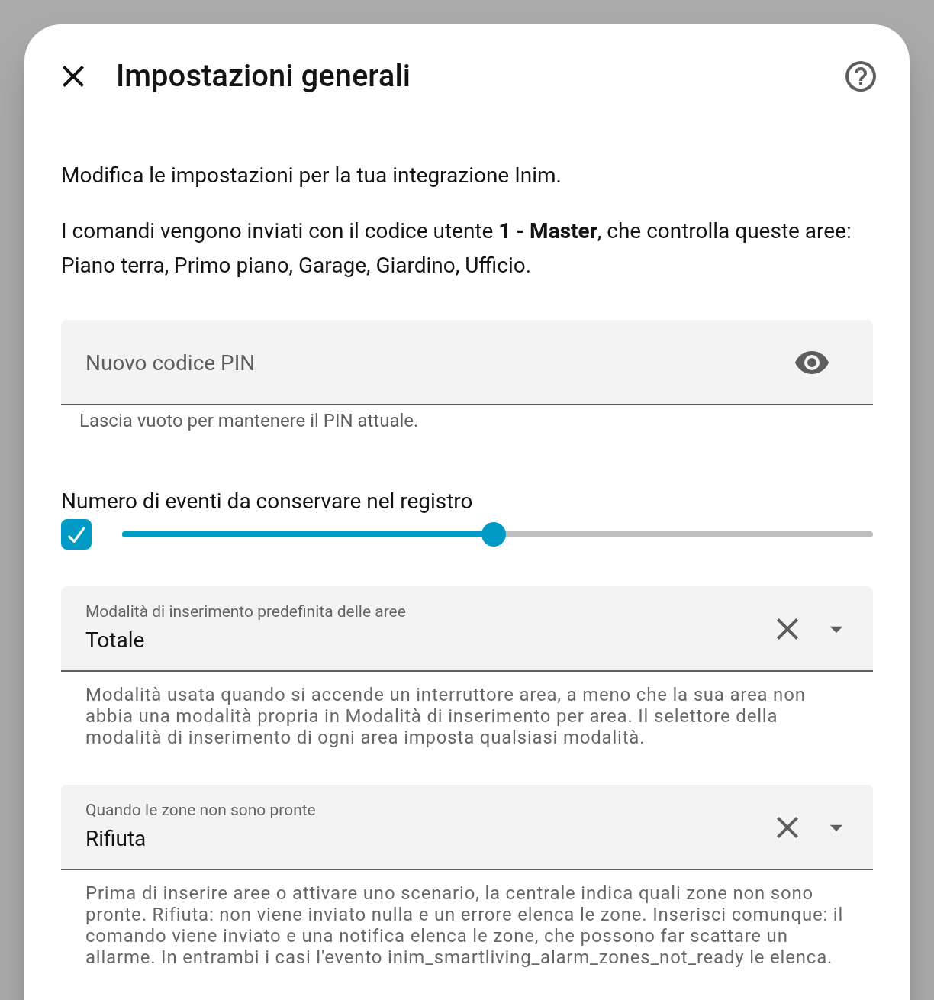
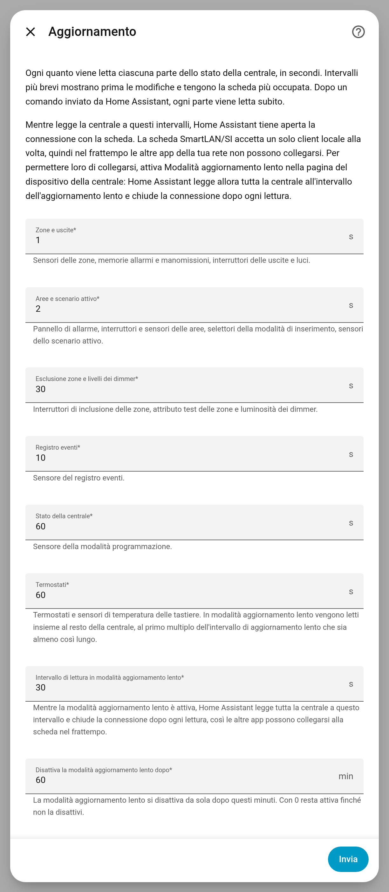
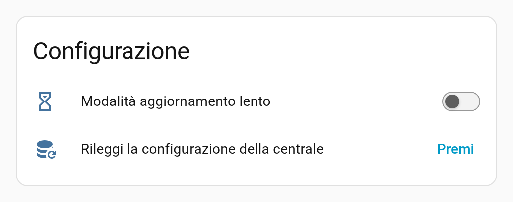

# Opzioni { #options }

Le opzioni stabiliscono come l'integrazione legge la tua centrale e cosa fa quando inserisci. Alcune le scegli quando aggiungi la centrale, e puoi cambiarle tutte in seguito.

## Opzioni iniziali { #initial-options }

Quando aggiungi una centrale, l'ultimo passaggio chiede:

*   **Numero di eventi da conservare nel registro**: quanti eventi recenti conserva il sensore del registro eventi.
*   **Scenario inserimento parziale (casa), totale (fuori), notte, vacanza e Scenario disinserimento**: quale dei tuoi scenari attiva la scheda *Pannello degli Allarmi* per ogni pulsante. Una modalità di inserimento senza scenario non viene proposta; il disinserimento senza scenario non riesce, con un messaggio.

La configurazione propone lo scenario di **inserimento totale (fuori)** e quello di **disinserimento** in base a cosa fanno i tuoi scenari alle aree che importi. Controlla la mappatura proposta e cambiala se necessario.

??? note "Come vengono proposti gli scenari di inserimento totale e di disinserimento"

    *   **Inserimento totale (fuori)**: uno scenario importato che inserisce tutte le aree importate (prima uno che le inserisce tutte in modalità totale, poi quello con il numero più basso).
    *   **Disinserimento**: lo scenario importato con il numero più basso che disinserisce tutte le aree importate.

    Quello che uno scenario fa alle aree che non importi non conta. Se nessuno scenario va bene, la modalità resta senza scenario. Vengono proposti solo gli scenari che importi, e i campi di associazione compaiono solo se è importato almeno uno scenario.

## Cambiare le opzioni in seguito { #changing-the-options-later }

1.  Vai in **Impostazioni** → **Dispositivi e servizi** e apri **Inim SmartLiving Alarm**.
2.  Fai clic sull'icona dell'ingranaggio (⚙) nella riga della tua centrale (nelle versioni di Home Assistant precedenti alla 2026.11, **Configura**).
3.  Scegli cosa cambiare:

    { width="480" }

    *   **Aree, zone, scenari, uscite e termostati**: cosa importare. Lo stesso passaggio della configurazione.
    *   **Modalità di inserimento per area**: la modalità in cui l'interruttore di ogni area inserisce, se non è quella generale.
    *   **Impostazioni generali**: tutto il resto, compreso un nuovo PIN.
    *   **Aggiornamento**: ogni quanto viene letta ciascuna parte dello stato della centrale.

4.  Fai clic su **Invia**. L'integrazione si ricarica con le nuove opzioni.

### Aree, zone, scenari, uscite e termostati { #areas-zones-scenarios-outputs-and-thermostats }

Seleziona quello che vuoi in Home Assistant. Deselezionare un'area, una zona, uno scenario, un'uscita o un termostato **rimuove le sue entità**, insieme a ogni nome o ID entità che gli hai dato; selezionandolo di nuovo, le entità tornano con i loro ID originali.

Le tastiere che rilevano la temperatura ambiente hanno il termostato selezionato durante la configurazione, anche se non lo usi; deseleziona quelli che non vuoi (vedi [Termostati](entities.md#thermostats)).

Uno scenario usato da una modalità del pannello di allarme non si può deselezionare: prima scegli un altro scenario per quella modalità in **Impostazioni generali**.

### Modalità di inserimento per area { #area-switches-arm-mode-per-area }

L'interruttore di ogni area, quando lo accendi, inserisce nella modalità scelta qui. *Usa la predefinita* segue **Modalità di inserimento predefinita delle aree** in **Impostazioni generali**. Per esempio, puoi impostare le camere da letto su *Parziale* e lasciare le altre sulla predefinita.

{ width="480" }

### Impostazioni generali { #general-settings }

{ width="480" }

Il passaggio indica il codice utente a cui appartiene il PIN attuale e le aree che comanda. Lascia vuoto **Nuovo codice PIN** per mantenere il PIN attuale; un nuovo PIN viene verificato con la centrale come durante la configurazione.

### Aggiornamento { #polling }

{ width="480" }

L'integrazione legge lo stato della centrale a parti, ciascuna con il proprio intervallo, in secondi:

| Campo | Aggiorna | Predefinito |
|---|---|---|
| **Zone e uscite** | sensori delle zone, memorie allarmi e manomissioni, interruttori delle uscite e luci | 1 |
| **Aree e scenario attivo** | il pannello di allarme, gli interruttori e i sensori delle aree, i selettori della modalità di inserimento, i sensori dello scenario attivo | 2 |
| **Esclusione zone e livelli dei dimmer** | gli interruttori *Zona N inclusa*, l'attributo `test` delle zone, la luminosità dei dimmer | 30 |
| **Registro eventi** | il sensore del registro eventi | 10 |
| **Stato della centrale** | il sensore *Modalità programmazione* | 60 |
| **Termostati** | i termostati e i sensori di temperatura delle tastiere | 60 |

*   Dopo un comando inviato da Home Assistant (un inserimento, uno scenario, un'esclusione, un'uscita), ogni parte viene letta subito, qualunque sia il suo intervallo.
*   Intervalli più brevi mostrano prima i cambiamenti e tengono la scheda più occupata. Con i valori predefiniti l'integrazione invia circa tre richieste al secondo.
*   Se la centrale non riesce a rispondere alla velocità che un intervallo chiede, le letture arrivano semplicemente più tardi, e il log lo segnala una volta.
*   L'impostazione di Home Assistant **Abilita il rilevamento delle variazioni** (voce della centrale, menu ⋮, **Opzioni di sistema**) disattiva tutte le letture programmate; i comandi e l'azione `homeassistant.update_entity` leggono comunque la centrale.

!!! note "Una connessione locale alla volta"

    Mentre Home Assistant legge la centrale a questi intervalli, tiene aperta la connessione alla scheda. La scheda SmartLAN/SI accetta un client locale alla volta, quindi nel frattempo le altre app sulla tua rete (come l'app Inim o il software dell'installatore) non riescono a collegarsi. Per lasciarle collegare, attiva la [modalità aggiornamento lento](#slow-polling-mode). L'accesso remoto tramite Inim Cloud non ne risente.

### Modalità aggiornamento lento { #slow-polling-mode }

{ width="400" }

Con una scheda SmartLAN/SI, la pagina del dispositivo della centrale ha un interruttore **Modalità aggiornamento lento** (nella sezione *Configurazione*). Mentre è attivo, Home Assistant legge tutta la centrale una volta ogni **Intervallo di lettura in modalità aggiornamento lento** (30 secondi per impostazione predefinita) e chiude la connessione dopo ogni lettura e ogni comando. Tra una lettura e l'altra, l'app Inim e il software dell'installatore possono collegarsi alla scheda.

*   I cambiamenti sulla centrale compaiono fino a un intervallo più tardi, come con l'unico intervallo di aggiornamento delle versioni precedenti.
*   Mentre un'altra app è collegata, Home Assistant non riesce a raggiungere la scheda: le entità non sono disponibili finché l'altra app non si scollega, e i comandi inviati da Home Assistant non riescono, con un messaggio che la scheda non è raggiungibile o è usata da un'altra app. Mentre il software dell'installatore legge la programmazione della centrale (può durare circa un minuto) il log può indicare per quanto tempo la centrale non ha risposto.
*   La lettura di Home Assistant può a volte occupare la scheda tra due connessioni del software dell'installatore. Se poi il software dell'installatore segnala un errore di connessione, riprova.
*   La modalità si disattiva da sola dopo **Disattiva la modalità aggiornamento lento dopo** (60 minuti per impostazione predefinita). Impostalo a 0 per tenerla attiva finché non la disattivi tu, per esempio se usi ogni giorno l'app Inim sulla tua rete. Resta attiva, con la stessa ora di fine, quando Home Assistant si riavvia. Se un'altra app occupa la scheda mentre Home Assistant si avvia, l'integrazione all'inizio non riesce a configurarsi e riprova da sola poco dopo.
*   Per effettuare in sicurezza la programmazione sulla centrale tramite Software, è ad ogni modo consigliabile disabilitare l'integrazione per il tempo necessario al compmletamento, in modo da assicurarsi che non vi siano interferenze.
*   I termostati vengono letti insieme al resto della centrale, a ogni lettura o a una ogni tanto: al primo multiplo dell'intervallo dell'aggiornamento lento che sia almeno pari all'intervallo **Termostati**.
*   Quando si disattiva, ogni parte della centrale viene letta subito, poi agli intervalli qui sopra.
*   Per averla attiva a orari stabiliti, usa un'automazione che accende e spegne l'interruttore.

??? example "Automazione: modalità aggiornamento lento la sera"

    Nell'editor delle automazioni, **Modifica in YAML**:

    ```yaml
    alias: Modalità aggiornamento lento la sera
    triggers:
      - trigger: time
        at: "19:00:00"
        id: "on"
      - trigger: time
        at: "23:00:00"
        id: "off"
    actions:
      - action: switch.turn_{{ trigger.id }}
        target:
          entity_id: switch.home_slow_polling_mode
    ```

    Imposta **Disattiva la modalità aggiornamento lento dopo** a 0, o ad almeno 240 minuti, così che non finisca prima delle 23:00. Sostituisci `switch.home_slow_polling_mode` con l'ID entità del tuo interruttore.

## Tutte le opzioni { #all-options }

| Opzione | Dove | Valori | Predefinito | Cosa fa |
|---|---|---|---|---|
| **Numero di eventi da conservare nel registro** | configurazione, Impostazioni generali | da 1 a 100 | 50 | Quanti eventi recenti il sensore del registro eventi conserva nei suoi attributi. |
| **Scenario inserimento parziale (casa)** | configurazione, Impostazioni generali | *Nessuno (non assegnare)* o uno scenario importato | nessuno | Lo scenario che attiva il pulsante *Attiva in casa* del pannello di allarme. |
| **Scenario inserimento totale (fuori)** | configurazione, Impostazioni generali | come sopra | proposto | Lo scenario che attiva il pulsante *Attiva fuori casa* del pannello di allarme. |
| **Scenario inserimento notte** | configurazione, Impostazioni generali | come sopra | nessuno | Lo scenario che attiva il pulsante *Attiva notte* del pannello di allarme. |
| **Scenario inserimento vacanza** | configurazione, Impostazioni generali | come sopra | nessuno | Lo scenario che attiva il pulsante *Attiva in vacanza* del pannello di allarme. |
| **Scenario disinserimento** | configurazione, Impostazioni generali | come sopra | proposto | Lo scenario che attiva il pulsante *Disattiva* del pannello di allarme. |
| **Modalità di inserimento predefinita delle aree** | Impostazioni generali | *Totale*, *Parziale*, *Immediata* | *Totale* | La modalità in cui l'interruttore di un'area inserisce quando viene acceso. Il selettore della modalità di inserimento di ogni area offre tutte le modalità. |
| **Modalità di inserimento per area** | un passaggio a sé | *Usa la predefinita*, *Totale*, *Parziale*, *Immediata*, per ogni area | *Usa la predefinita* | Una modalità diversa per gli interruttori di singole aree. |
| **Quando le zone non sono pronte** | Impostazioni generali | *Rifiuta*, *Inserisci comunque e avvisa* | *Rifiuta* | Cosa succede quando all'inserimento ci sono zone non pronte; vedi [Zone non pronte](actions-events.md#zones-not-ready). |
| **Nuovo codice PIN** | Impostazioni generali | da 1 a 6 cifre, o vuoto | vuoto | Un nuovo PIN, verificato con la centrale. Vuoto mantiene il PIN attuale. |
| **Zone e uscite** | Aggiornamento | da 0,5 a 60 | 1 | Secondi tra una lettura e l'altra delle zone e delle uscite. |
| **Aree e scenario attivo** | Aggiornamento | da 0,5 a 60 | 2 | Secondi tra una lettura e l'altra delle aree e dello scenario attivo. |
| **Esclusione zone e livelli dei dimmer** | Aggiornamento | da 5 a 300 | 30 | Secondi tra una lettura e l'altra dell'esclusione e del test delle zone e dei livelli dei dimmer. |
| **Registro eventi** | Aggiornamento | da 1 a 300 | 10 | Secondi tra una lettura e l'altra del registro eventi. |
| **Stato della centrale** | Aggiornamento | da 10 a 600 | 60 | Secondi tra una lettura e l'altra dello stato della centrale (modalità programmazione). |
| **Termostati** | Aggiornamento | da 10 a 600 | 60 | Secondi tra una lettura e l'altra dei termostati e delle temperature delle tastiere; solo con un termostato importato. |
| **Intervallo di lettura in modalità aggiornamento lento** | Aggiornamento (SmartLAN/SI) | da 10 a 300 | 30 | Secondi tra una lettura e l'altra di tutta la centrale mentre la [modalità aggiornamento lento](#slow-polling-mode) è attiva. |
| **Disattiva la modalità aggiornamento lento dopo** | Aggiornamento (SmartLAN/SI) | da 0 a 1440 | 60 | Minuti dopo i quali la modalità aggiornamento lento si disattiva da sola; 0 la tiene attiva finché non la disattivi tu. |

L'indirizzo, la porta, il nome utente e la password della scheda si cambiano con **Riconfigura** (vedi [Configurazione](setup.md#changing-the-connection-details-reconfigure)).
