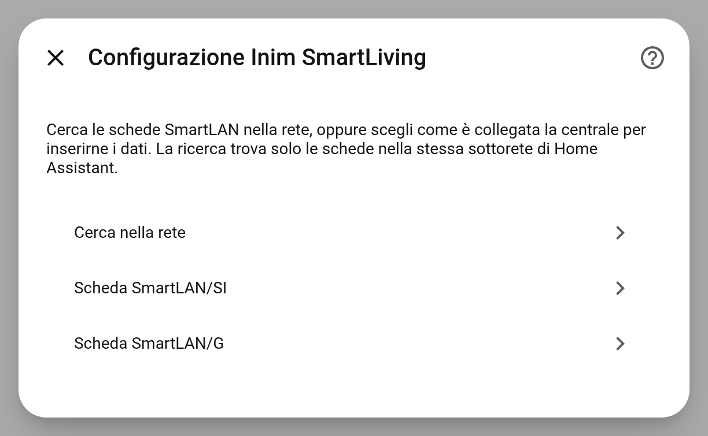
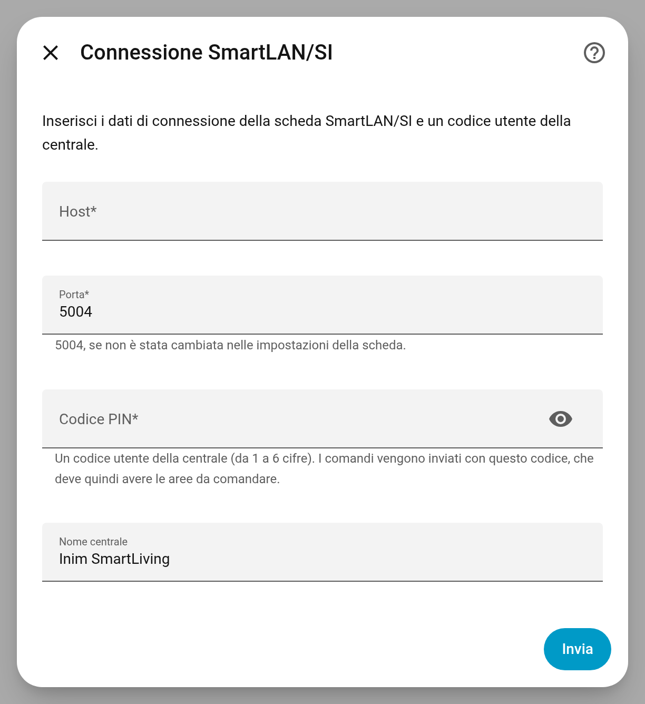
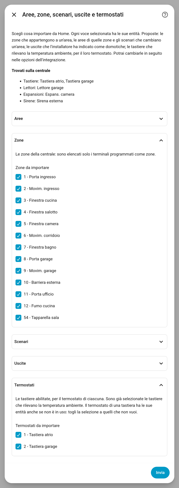
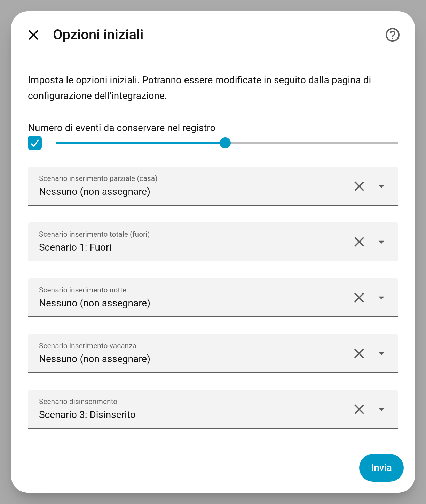

# Configurazione { #setup }

Questa pagina spiega come aggiungere la tua centrale a Home Assistant, come cambiarne in seguito i dati di connessione e come rileggerne la configurazione dopo una modifica sulla centrale.

## Aggiungere una centrale { #adding-a-panel }

Dopo aver [installato](installation.md#installing) l'integrazione e riavviato Home Assistant:

1.  Vai in **Impostazioni** → **Dispositivi e servizi**.
2.  Fai clic su **Aggiungi integrazione**, cerca **Inim SmartLiving Alarm** e selezionala.
3.  Scegli come trovare la centrale:

    { width="480" }

    *   **Cerca nella rete** elenca le schede SmartLAN che rispondono e non sono ancora configurate. Scegli la tua, e indirizzo e porta vengono compilati per te. La ricerca trova solo le schede nella **stessa subnet di Home Assistant**.
    *   **Scheda SmartLAN/SI** o **Scheda SmartLAN/G**: inserisci tu i dati. Usa queste voci quando la ricerca non trova la tua scheda.

4.  Inserisci l'indirizzo della scheda, la porta e il tuo PIN, e dai un nome alla centrale. I campi sono descritti [più avanti](#connection-fields).

    { width="480" }

5.  Fai clic su **Invia**. L'integrazione si collega alla centrale, la verifica e ne legge la configurazione. Se la configurazione viene rifiutata, il messaggio dice perché (vedi [più avanti](#why-the-setup-can-be-refused)).
6.  Scegli le **aree, zone, scenari, uscite e termostati** da importare. Ogni voce che selezioni ha le sue entità. Quello che la centrale mostra come in uso è già selezionato; cambialo se vuoi.

    { width="560" }

7.  Imposta le **Opzioni iniziali**: quanti eventi conservare e quali scenari usa la scheda *Pannello degli Allarmi*. Vedi [Opzioni](options.md#initial-options).

    { width="480" }

8.  Fai clic su **Invia**. La centrale compare come dispositivo con le sue entità: vedi [Entità](entities.md).

### Campi della connessione { #connection-fields }

| Campo | Serve per | Cosa inserire |
|---|---|---|
| **Host** | entrambe le schede | L'indirizzo IP della scheda, per esempio `192.168.1.100`. |
| **Porta** | entrambe le schede | La porta TCP della scheda: 5004, se non è stata cambiata nelle impostazioni della scheda. |
| **Nome utente della scheda** e **Password della scheda** | solo SmartLAN/G | Il nome utente e la password della pagina web della scheda. La scheda li usa per cifrare la connessione. |
| **Codice PIN** | entrambe le schede | Un PIN utente della centrale, da 1 a 6 cifre. I comandi vengono inviati con questo PIN, quindi deve avere le aree che vuoi comandare. |
| **Nome centrale** | facoltativo | Il nome della centrale in Home Assistant, per esempio `Home`. Gli ID delle entità iniziano con questo nome. |

### Cosa elenca il passaggio delle voci { #what-the-items-step-lists }

??? note "Aree, zone, scenari, uscite e dispositivi"

    *   **Aree**: tutte le aree della centrale (5 su una SmartLiving 505 o 515, 10 su una 1050, 15 su una 10100).
    *   **Zone**: le zone della centrale. Sono elencati solo i terminali programmati come zone (non le uscite né i terminali inutilizzati), comprese le seconde zone dei terminali doppi (da 11 a 20 sulla 505, da 21 a 40 sulla 515, da 51 a 100 sulla 1050, da 101 a 200 sulla 10100).
    *   **Scenari**: tutti gli scenari della centrale (30).
    *   **Uscite**: le uscite che il tuo codice utente può comandare, con il loro tipo (on/off, monostabile con il suo tempo, o dimmer); la sezione compare solo se ce ne sono. **Sono selezionate solo le uscite che l'installatore ha contrassegnato come domotiche** (firmware 6): un'uscita può comandare una sirena, una serratura o un cancello, quindi seleziona solo quelle che intendi comandare da Home Assistant (vedi [Uscite](entities.md#outputs)).
    *   **Trovati sulla centrale**: le tastiere, i lettori, le espansioni e le sirene abilitati sulla centrale, per nome, come riferimento.

    La configurazione seleziona quello che la centrale mostra come in uso: le zone che appartengono a un'area, le aree di quelle zone, gli scenari che cambiano almeno un'area e le uscite che l'installatore ha contrassegnato come domotiche. Ogni sezione si può espandere o contrarre.

### Perché la configurazione può essere rifiutata { #why-the-setup-can-be-refused }

| Messaggio | Cosa fare |
|---|---|
| Connessione fallita. Controlla l'Host e la Porta … | Controlla l'indirizzo e la porta, che Home Assistant possa raggiungere la scheda e che nessun altro programma sia collegato (vedi [Risoluzione dei problemi](troubleshooting.md#common-problems)). |
| Il PIN deve avere da 1 a 6 cifre. | Inserisci il PIN solo con cifre. |
| Il PIN non corrisponde a nessun codice utente della centrale. | Inserisci il PIN di un codice utente programmato sulla centrale. |
| La scheda SmartLAN/G non ha accettato la connessione. | Controlla il nome utente e la password della scheda. |
| La scheda SmartLAN/G ha risposto, ma la risposta non è nel formato previsto. | Se nome utente e password sono corretti, la tua scheda potrebbe rispondere in un modo che l'integrazione non gestisce ancora: vedi [Risoluzione dei problemi](troubleshooting.md#common-problems). |
| La centrale è in programmazione … | Riprova al termine della programmazione. |
| Il firmware della centrale non è supportato: serve il firmware 5.1 o successivo. | Un firmware precedente al 5.1 non si può configurare. |
| Questo modello SmartLiving non è ancora supportato. | Segnala il modello e il firmware su GitHub. |
| Questa centrale di allarme è già configurata. | La centrale è già configurata in Home Assistant. |

## Cambiare i dati di connessione (Riconfigura) { #changing-the-connection-details-reconfigure }

Se l'indirizzo, la porta o il PIN della tua centrale cambiano (oppure, per SmartLAN/G, il nome utente o la password della scheda), non serve rimuovere e aggiungere di nuovo l'integrazione:

1.  Vai in **Impostazioni** → **Dispositivi e servizi** e apri **Inim SmartLiving Alarm**.
2.  Apri il menu (⋮) della voce della tua centrale e scegli **Riconfigura**.
3.  Inserisci i nuovi dati e fai clic su **Invia**. Il PIN e la password della scheda non sono precompilati: lasciali vuoti per mantenere quelli attuali.

L'integrazione contatta la centrale con i nuovi dati, ne rilegge la configurazione e si ricarica. Le tue opzioni, entità e ID delle entità vengono mantenuti; solo una tastiera abilitata nel frattempo, che rileva la temperatura ambiente, ha il suo termostato già selezionato.

??? note "Cosa verifica Riconfigura"

    *   Se la centrale non è raggiungibile, viene mostrato un errore e non cambia nulla.
    *   Un indirizzo già usato da un'altra centrale configurata viene rifiutato, e così un PIN che non corrisponde a nessun codice utente della centrale.
    *   Il tipo di scheda (SmartLAN/SI o SmartLAN/G) non si può cambiare qui: per farlo, rimuovi l'integrazione e aggiungila di nuovo.

## Rileggere la configurazione della centrale { #re-reading-the-panel-configuration }

L'integrazione legge i nomi e la programmazione della centrale quando la aggiungi: i nomi di aree, zone, scenari, codici utente, chiavi, tastiere, lettori, espansioni, timer, sirene e numeri di telefono (solo i nomi); quali tastiere, lettori, espansioni e sirene sono abilitati; le impostazioni delle zone e la definizione degli scenari. Se li cambi in seguito sulla centrale (da una tastiera o dal software dell'installatore), rileggili con:

*   il pulsante **Rileggi la configurazione della centrale**, nella sezione *Configurazione* della pagina del dispositivo della centrale, oppure
*   l'azione **Rileggi la configurazione della centrale**, `inim_smartliving_alarm.reread_panel_configuration` (vedi [Azioni](actions-events.md#action-reread-panel-configuration)).

L'integrazione si ricarica poi con la nuova configurazione.

??? note "Cosa cambia dopo una rilettura"

    *   Le tue opzioni non cambiano e gli ID delle entità restano gli stessi; i nomi delle entità seguono i nuovi nomi della centrale. Un'eccezione: una tastiera abilitata dopo l'ultima lettura che rileva la temperatura ambiente ha il suo termostato già selezionato; i termostati che hai deselezionato restano deselezionati.
    *   Nemmeno le aree, zone e scenari che importi cambiano: una zona cablata in seguito o un nuovo scenario compare, non selezionato, nelle opzioni in **Aree, zone, scenari, uscite e termostati**.
    *   Se la centrale non è raggiungibile, o è in programmazione, viene mostrato un errore e la configurazione salvata viene mantenuta: in programmazione, riprova al termine della programmazione.
