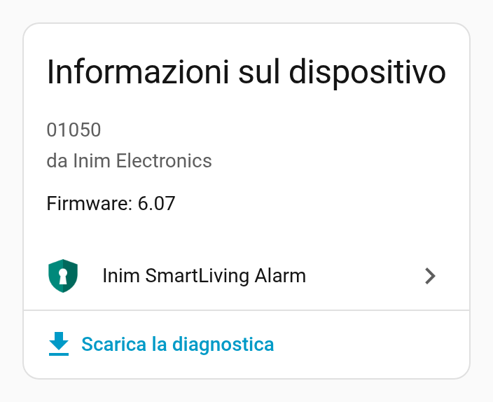

# Report di sistema { #system-report }

Quando segnali un problema, un report di sistema dice cosa sa l'integrazione della tua centrale: modello e firmware, scheda, la programmazione della centrale come letta da essa, lo stato, il registro eventi, le opzioni e le entità dell'integrazione, e le statistiche di connessione.

## Condividere un report { #sharing-a-report }

1.  Apri la pagina del dispositivo della centrale: **Impostazioni** → **Dispositivi e servizi** → **Inim SmartLiving Alarm** → la tua centrale.
2.  Fai clic su **Scarica la diagnostica** nella scheda *Informazioni sul dispositivo*.

    { width="352" }

3.  Attendi il file: con SmartLAN/SI richiede circa 40 secondi. Nel frattempo i comandi non vengono trattenuti.
4.  Allega il file alla tua issue su GitHub. Se GitHub rifiuta il file, prima comprimilo in uno zip.

La stessa voce è nel menu (⋮) della tua centrale nella pagina dell'integrazione.

### Cosa mostra il report { #how-much-the-report-shows }

Il selettore *Livello diagnostica* sceglie quanto mostra il prossimo report. È disattivato per impostazione predefinita: attivalo nella pagina del dispositivo, nella sezione *Diagnostica*.

| Livello | Cosa contiene |
|---|---|
| **Oscurato** (predefinito) | Tutto ciò che è sicuro per una condivisione: la programmazione, lo stato, gli eventi con i loro orari, le statistiche. I nomi sono tagliati ai primi 3 caratteri, il numero di serie alle ultime 4 cifre, l'indirizzo MAC della scheda agli ultimi 2 byte; indirizzi, PIN, numeri di telefono, numeri di serie delle chiavi e password sono esclusi. Si può pubblicare senza rischi. |
| **Completo** | Anche i nomi, il numero di serie e gli indirizzi di rete. PIN, numeri di telefono, numeri di serie delle chiavi, password e il nome utente del DNS dinamico della scheda restano esclusi. |
| **Completo riservato** | Tutto, compresi i PIN (anche il codice installatore), i numeri di telefono, i numeri di serie delle chiavi e le password e il nome utente del DNS dinamico della scheda. |

Con **Oscurato**, un solo download dà un file in chiaro che puoi allegare così com'è a una issue su GitHub.

??? note "Completo e Completo riservato: due file"

    Con **Completo** e **Completo riservato** ricevi due file dalla stessa lettura della centrale:

    1.  Il primo download è **cifrato** con la chiave del manutentore: solo la chiave privata corrispondente lo decifra. Contiene anche la vista Oscurato in chiaro. **Allega questo file alla tua issue su GitHub**; è l'unico file da condividere.
    2.  Scarica di nuovo la diagnostica entro 10 minuti per avere una **copia leggibile** dello stesso report (contiene `PRIVATE COPY`), per controllare cosa condividi. **Non condividerla**: tienila privata ed eliminala quando non ti serve più. Una notifica te lo ricorda dopo il primo download. I due file hanno lo stesso nome, quindi il browser salva il secondo con un numero aggiunto (per esempio `(1)`): allega il primo, che contiene `encrypted` e `redacted_view`, MAI quello che contiene `PRIVATE COPY`.

    Poi il livello torna a *Oscurato*. Non viene salvato nulla: il report resta in memoria solo fino al secondo download, al massimo per 10 minuti.

??? note "Cosa viene letto e cosa no"

    I dati della scheda (le sue impostazioni di rete e il firmware) vengono letti dalla scheda stessa. A una scheda SmartLAN/SI vengono chiesti direttamente, quindi sono inclusi anche quando Home Assistant è in un'altra sottorete; se in quel momento la scheda è usata da un'altra app, il report ripiega su una ricerca nella rete di Home Assistant. I dati di una scheda SmartLAN/G sono inclusi solo quando Home Assistant è nella stessa rete della scheda. Cosa non viene mai letto, a nessun livello: le chiavi cloud della centrale, l'ID e l'indirizzo dell'account, e le chiavi interne della scheda.

### Trovare il codice installatore { #finding-the-installer-code }

Se non hai il codice installatore della tua centrale, un report **Completo riservato** lo mostra (firmware della centrale 5.1 o successivo):

1.  Imposta *Livello diagnostica* su *Completo riservato* e scarica la diagnostica due volte, come descritto sopra.
2.  Apri il secondo file, la copia leggibile, con il visualizzatore: `python3 scripts/inim_report.py show REPORT.json`. La riga **Installer code** del riepilogo lo mostra, con la sua posizione nella tabella dei PIN della centrale. Nel file stesso è in `panel` → `installer_code`.

La copia leggibile contiene tutti i PIN della tua centrale: tienila privata ed eliminala quando hai il codice. I report degli altri livelli non mostrano mai il codice installatore.

## Leggere un report { #reading-a-report }

Il repository contiene un visualizzatore per i report, `scripts/inim_report.py` (Python 3.13 o successivo; per leggere non serve installare nulla). Scarica il repository da GitHub, poi:

*   `python3 scripts/inim_report.py show REPORT.json` mostra un report: prima un riepilogo e le osservazioni, poi aree, zone, scenari, codici, dispositivi, uscite, lo stato attuale delle aree, lo stato, gli eventi, le opzioni dell'integrazione e la connessione. Aggiungi `--html report.html` per una pagina da aprire in un browser. L'elenco delle zone segna i numeri di zona che non sono zone sulla centrale (seconde zone di terminali che non sono doppi, zone di terminali di uscita o inutilizzati), e i conteggi degli stati delle zone li escludono; i report fatti dalla 0.4 non hanno questi segni.
*   `python3 scripts/inim_report.py check REPORT.json` dice se un file è quello da allegare (il report Oscurato, o quello cifrato) oppure la copia privata, che non devi condividere.

Un report cifrato si legge con `show REPORT.json --decrypt` (aggiungi `--html report.html` per la pagina); serve la chiave privata corrispondente e il pacchetto Python `cryptography`. Legge solo i file: non si collega a nulla. Puoi usarlo per vedere il tuo report Oscurato e la tua copia leggibile; il file cifrato mostra la sua vista Oscurato.
