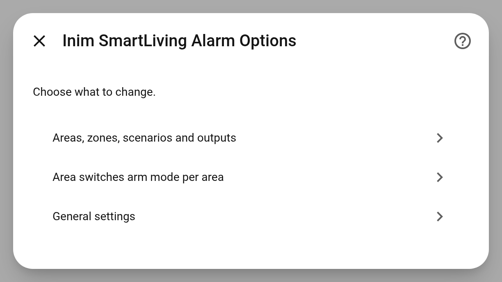
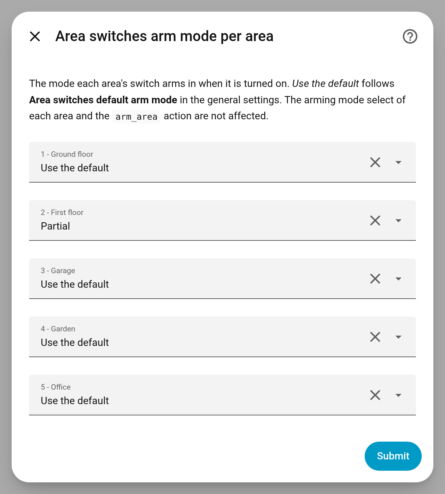

# Options

Options set how the integration reads your panel and what it does when you arm. You choose some of them when you add the panel, and can change all of them later.

## Initial options

When you add a panel, the last step asks for:

*   **Polling Interval (seconds)**: how often Home Assistant reads the panel's state.
*   **Number of Events to store in log**: how many recent events the event log sensor keeps.
*   **Arm Home, Arm Away, Arm Night, Arm Vacation and Disarm Scenario**: which of your scenarios the alarm panel card runs for each button. An arm mode without a scenario is not offered; Disarm without a scenario fails with a message.

The setup proposes **Arm Away** and **Disarm** from what your scenarios do to the areas you import. Check the proposal and change it if you like.

??? note "How Arm Away and Disarm are proposed"

    *   **Arm Away**: an imported scenario that arms every imported area (one that arms them all in total mode first, then the lowest number).
    *   **Disarm**: the lowest-numbered imported scenario that disarms every imported area.

    What a scenario does to areas you do not import does not matter. If no scenario fits, the mode stays without a scenario. Only the scenarios you import are offered, and the mapping fields are shown only when at least one scenario is imported.

## Changing the options later

1.  Go to **Settings** → **Devices & services** and open **Inim SmartLiving Alarm**.
2.  Click the gear icon (⚙) on your panel's row (on Home Assistant versions before 2026.11, **Configure**).
3.  Choose what to change:

    { width="480" }

    *   **Areas, zones, scenarios and outputs**: what to import. The same step as at setup.
    *   **Area switches arm mode per area**: the mode each area's switch arms in, if not the general one.
    *   **General settings**: everything else, including a new PIN.

4.  Click **Submit**. The integration reloads with the new options.

### Areas, zones, scenarios and outputs

Tick what you want in Home Assistant. Unticking an area, zone, scenario or output **removes its entities**, together with any name or entity ID you gave them; ticking it again brings them back with their original entity IDs.

A scenario that an alarm panel mode uses cannot be unticked: choose another scenario for that mode in **General settings** first.

### Area switches arm mode per area

Each area's switch arms in the mode chosen here when you turn it on. *Use the default* follows **Area switches default arm mode** in **General settings**. For example, set the bedrooms to *Partial* and leave the others at the default.

{ width="480" }

### General settings

{ width="480" }

The step names the user code the current PIN belongs to and the areas it controls. Leave **New PIN Code** empty to keep the current PIN; a new PIN is checked with the panel as at setup.

## All options

| Option | Where | Values | Default | What it does |
|---|---|---|---|---|
| **Polling Interval (seconds)** | setup, General settings | 5 to 300 | 30 | How often the panel's state is read. Shorter intervals show changes sooner and keep the board busier. |
| **Number of Events to store in log** | setup, General settings | 1 to 100 | 50 | How many recent events the event log sensor keeps in its attributes. |
| **Arm Home Scenario** | setup, General settings | *None (Do Not Assign)* or an imported scenario | none | The scenario the alarm panel's Arm Home runs. |
| **Arm Away Scenario** | setup, General settings | as above | proposed | The scenario the alarm panel's Arm Away runs. |
| **Arm Night Scenario** | setup, General settings | as above | none | The scenario the alarm panel's Arm Night runs. |
| **Arm Vacation Scenario** | setup, General settings | as above | none | The scenario the alarm panel's Arm Vacation runs. |
| **Disarm Scenario** | setup, General settings | as above | proposed | The scenario the alarm panel's Disarm runs. |
| **Area switches default arm mode** | General settings | *Total*, *Partial*, *Instant* | *Total* | The mode an area switch arms in when turned on. The arming mode select of each area offers every mode. |
| **Area switches arm mode per area** | its own step | *Use the default*, *Total*, *Partial*, *Instant*, for each area | *Use the default* | A different mode for single areas' switches. |
| **When zones are not ready** | General settings | *Refuse*, *Arm anyway and warn* | *Refuse* | What happens when zones are not ready at arming; see [Zones not ready](actions-events.md#zones-not-ready). |
| **New PIN Code** | General settings | 1 to 6 digits, or empty | empty | A new PIN, checked with the panel. Empty keeps the current PIN. |

The board's address, port, user name and password are changed with **Reconfigure** (see [Setup](setup.md#changing-the-connection-details-reconfigure)).
