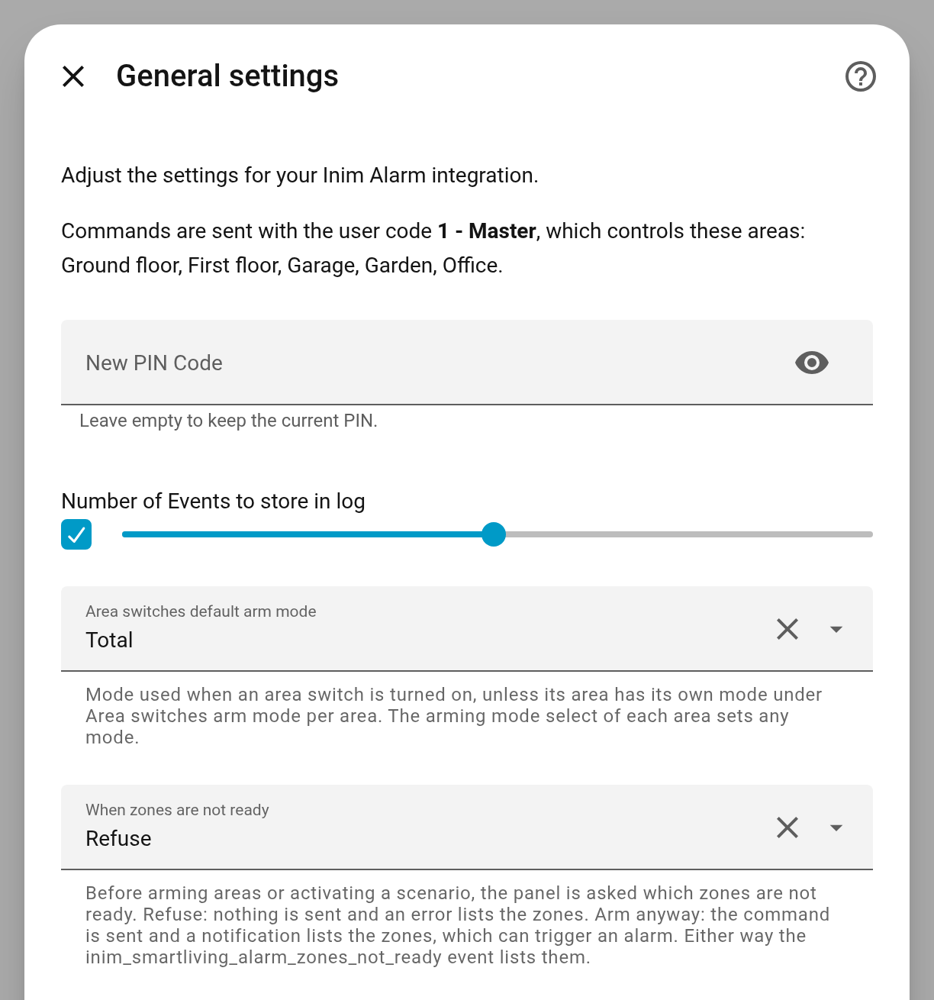
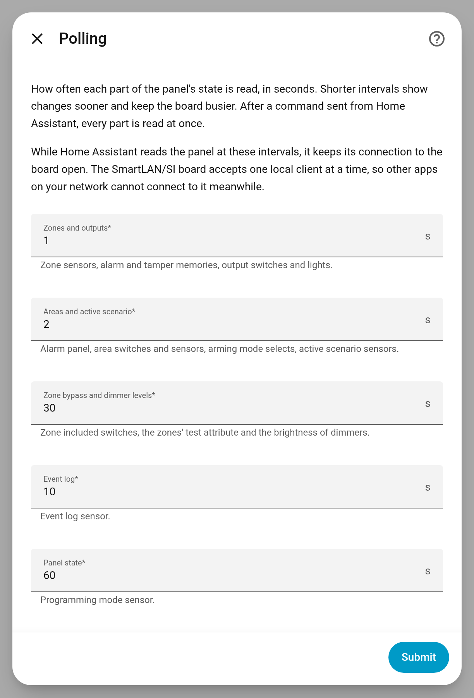
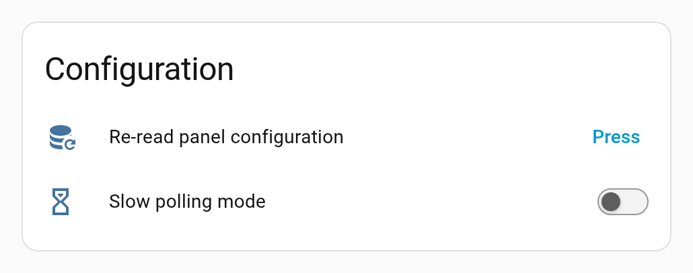

# Options

Options set how the integration reads your panel and what it does when you arm. You choose some of them when you add the panel, and can change all of them later.

## Initial options

When you add a panel, the last step asks for:

*   **Number of Events to store in log**: how many recent events the event log sensor keeps.
*   **Arm Home, Arm Away, Arm Night, Arm Vacation and Disarm Scenario**: which of your scenarios the alarm panel card runs for each button. An arm mode without a scenario is not offered; Disarm without a scenario fails with a message.

The setup proposes **Arm Away** and **Disarm** from what your scenarios do to the areas you import. Check the proposal and change it if you like.

??? note "How Arm Away and Disarm are proposed"

    *   **Arm Away**: an imported scenario that arms every imported area (one that arms them all in total mode first, then the lowest number).
    *   **Disarm**: the lowest-numbered imported scenario that disarms every imported area.

    What a scenario does to areas you do not import does not matter. If no scenario fits, the mode stays without a scenario. Only the scenarios you import are offered, and the mapping fields are shown only when at least one scenario is imported.

## Changing the options later

1.  Go to **Settings** → **Devices & services** and open **Inim SmartLiving Alarm**.
2.  Click the gear icon (⚙) on your panel's row (on Home Assistant versions before 2026.11, **Configure**).
3.  Choose what to change:

    { width="480" }

    *   **Areas, zones, scenarios, outputs and thermostats**: what to import. The same step as at setup.
    *   **Area switches arm mode per area**: the mode each area's switch arms in, if not the general one.
    *   **General settings**: everything else, including a new PIN.
    *   **Polling**: how often each part of the panel's state is read.

4.  Click **Submit**. The integration reloads with the new options.

### Areas, zones, scenarios, outputs and thermostats

Tick what you want in Home Assistant. Unticking an area, zone, scenario, output or thermostat **removes its entities**, together with any name or entity ID you gave them; ticking it again brings them back with their original entity IDs.

The keypads that report a room temperature have their thermostat ticked at setup, also when you don't use it; untick those you don't want (see [Thermostats](entities.md#thermostats)).

A scenario that an alarm panel mode uses cannot be unticked: choose another scenario for that mode in **General settings** first.

### Area switches arm mode per area

Each area's switch arms in the mode chosen here when you turn it on. *Use the default* follows **Area switches default arm mode** in **General settings**. For example, set the bedrooms to *Partial* and leave the others at the default.

{ width="480" }

### General settings

{ width="480" }

The step names the user code the current PIN belongs to and the areas it controls. Leave **New PIN Code** empty to keep the current PIN; a new PIN is checked with the panel as at setup.

### Polling

{ width="480" }

The integration reads the panel's state in parts, each at its own interval, in seconds:

| Field | Updates | Default |
|---|---|---|
| **Zones and outputs** | zone sensors, alarm and tamper memories, output switches and lights | 1 |
| **Areas and active scenario** | the alarm panel, area switches and sensors, arming mode selects, the active scenario sensors | 2 |
| **Zone bypass and dimmer levels** | *Zone N included* switches, the zones' `test` attribute, the brightness of dimmers | 30 |
| **Event log** | the event log sensor | 10 |
| **Panel state** | the *Programming mode* sensor | 60 |
| **Thermostats** | the thermostats and the keypad temperature sensors | 60 |

*   After a command sent from Home Assistant (arming, a scenario, a bypass, an output), every part is read at once, whatever its interval.
*   Shorter intervals show changes sooner and keep the board busier. At the defaults the integration sends about three requests a second, well within what the board answers.
*   If the panel cannot answer as fast as an interval asks, the reads simply come later, and the log says so once.
*   Home Assistant's **Enable polling for updates** setting (the panel's entry, ⋮ menu, **System options**) turns all scheduled reads off; commands and the `homeassistant.update_entity` action still read the panel.

!!! note "One local connection at a time"

    While Home Assistant reads the panel at these intervals, it keeps its connection to the board open. The SmartLAN/SI board accepts one local client at a time, so other apps on your network (such as the Inim app or the installer software) cannot connect to it meanwhile. To let them connect, turn on [slow polling mode](#slow-polling-mode). Remote access through Inim Cloud is not affected.

### Slow polling mode

{ width="400" }

With a SmartLAN/SI board, the panel's device page has a **Slow polling mode** switch (in its *Configuration* section). While it is on, Home Assistant reads the whole panel once every **Reading interval in slow polling mode** (30 seconds by default) and closes its connection after each read and each command. Between the reads, the Inim app and the installer software can connect to the board.

*   Changes at the panel show up to one interval later, as with the single polling interval of earlier versions.
*   While another app is connected, Home Assistant cannot reach the board: the entities are unavailable until the app disconnects, and commands sent from Home Assistant fail with a message that the board can't be reached or is in use by another app. While the installer software reads the panel's programming, this can last about a minute; the log may then say how long the panel did not answer.
*   Home Assistant's own read can now and then take the board between two connections of the installer software. If the installer software then reports a connection error, try again.
*   The mode turns itself off after **Turn off slow polling mode after** (60 minutes by default). Set it to 0 to keep it on until you turn it off, for example if you use the Inim app on your network every day. It stays on, with the same end time, when Home Assistant restarts. If another app holds the board while Home Assistant starts, the integration cannot set up at first and tries again by itself a little later.
*   The thermostats are read together with the rest of the panel, on every read or every few reads: at the first multiple of the slow polling interval that is at least the **Thermostats** interval.
*   When it turns off, every part of the panel is read at once, then at the intervals above.
*   To have it on at set times, use an automation that turns the switch on and off.

??? example "Automation: slow polling mode in the evening"

    In the automation editor, **Edit in YAML**:

    ```yaml
    alias: Slow polling mode in the evening
    triggers:
      - trigger: time
        at: "19:00:00"
        id: "on"
      - trigger: time
        at: "23:00:00"
        id: "off"
    actions:
      - action: switch.turn_{{ trigger.id }}
        target:
          entity_id: switch.home_slow_polling_mode
    ```

    Set **Turn off slow polling mode after** to 0, or to at least 240 minutes, so that it does not end before 23:00. Replace `switch.home_slow_polling_mode` with your switch's entity ID.

## All options

| Option | Where | Values | Default | What it does |
|---|---|---|---|---|
| **Number of Events to store in log** | setup, General settings | 1 to 100 | 50 | How many recent events the event log sensor keeps in its attributes. |
| **Arm Home Scenario** | setup, General settings | *None (Do Not Assign)* or an imported scenario | none | The scenario the alarm panel's Arm Home runs. |
| **Arm Away Scenario** | setup, General settings | as above | proposed | The scenario the alarm panel's Arm Away runs. |
| **Arm Night Scenario** | setup, General settings | as above | none | The scenario the alarm panel's Arm Night runs. |
| **Arm Vacation Scenario** | setup, General settings | as above | none | The scenario the alarm panel's Arm Vacation runs. |
| **Disarm Scenario** | setup, General settings | as above | proposed | The scenario the alarm panel's Disarm runs. |
| **Area switches default arm mode** | General settings | *Total*, *Partial*, *Instant* | *Total* | The mode an area switch arms in when turned on. The arming mode select of each area offers every mode. |
| **Area switches arm mode per area** | its own step | *Use the default*, *Total*, *Partial*, *Instant*, for each area | *Use the default* | A different mode for single areas' switches. |
| **When zones are not ready** | General settings | *Refuse*, *Arm anyway and warn* | *Refuse* | What happens when zones are not ready at arming; see [Zones not ready](actions-events.md#zones-not-ready). |
| **New PIN Code** | General settings | 1 to 6 digits, or empty | empty | A new PIN, checked with the panel. Empty keeps the current PIN. |
| **Zones and outputs** | Polling | 0.5 to 60 | 1 | Seconds between reads of the zones and the outputs. |
| **Areas and active scenario** | Polling | 0.5 to 60 | 2 | Seconds between reads of the areas and the active scenario. |
| **Zone bypass and dimmer levels** | Polling | 5 to 300 | 30 | Seconds between reads of the zone bypass and test flags and the dimmer levels. |
| **Event log** | Polling | 1 to 300 | 10 | Seconds between reads of the event log. |
| **Panel state** | Polling | 10 to 600 | 60 | Seconds between reads of the panel state (programming mode). |
| **Thermostats** | Polling | 10 to 600 | 60 | Seconds between reads of the keypads' thermostats and temperatures; only with a thermostat imported. |
| **Reading interval in slow polling mode** | Polling (SmartLAN/SI) | 10 to 300 | 30 | Seconds between reads of the whole panel while [slow polling mode](#slow-polling-mode) is on. |
| **Turn off slow polling mode after** | Polling (SmartLAN/SI) | 0 to 1440 | 60 | Minutes after which slow polling mode turns itself off; 0 keeps it on until you turn it off. |

The board's address, port, user name and password are changed with **Reconfigure** (see [Setup](setup.md#changing-the-connection-details-reconfigure)).
