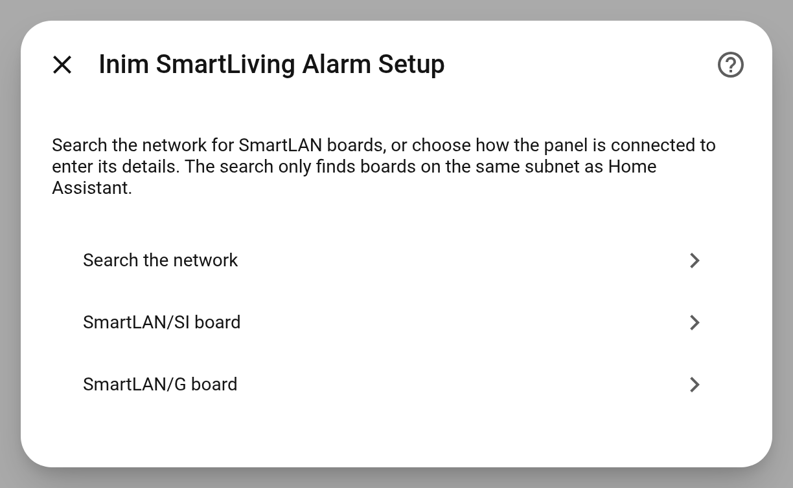
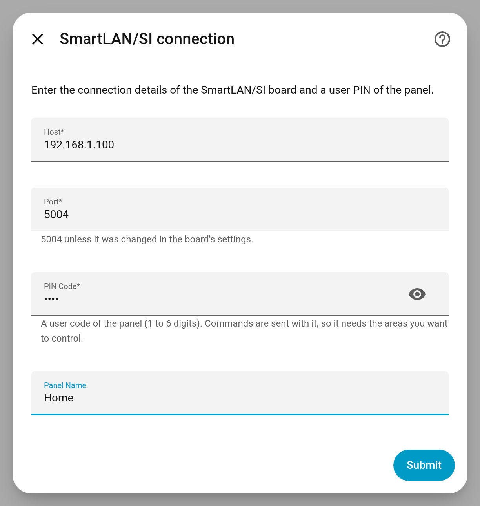
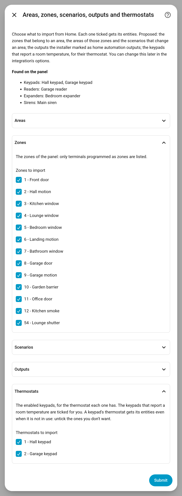
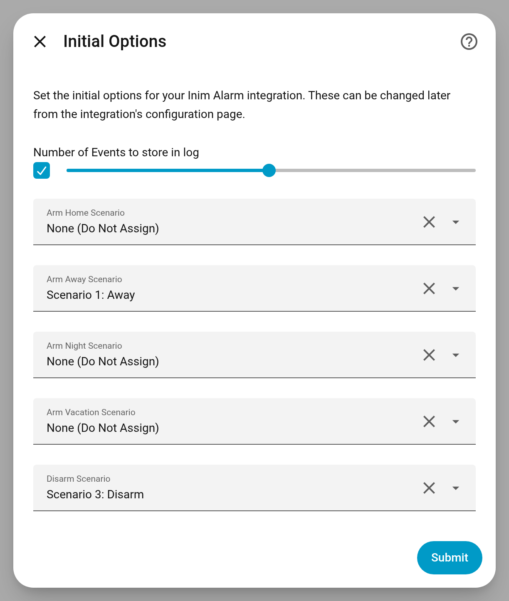

# Setup

This page shows how to add your panel to Home Assistant, how to change its connection details later, and how to read its configuration again after a change on the panel.

## Adding a panel

After [installing](installation.md#installing) the integration and restarting Home Assistant:

1.  Go to **Settings** → **Devices & services**.
2.  Click **Add integration**, search for **Inim SmartLiving Alarm** and select it.
3.  Choose how to find the panel:

    { width="480" }

    *   **Search the network** lists the SmartLAN boards that answer and are not set up yet. Pick yours, and its address and port are filled in for you. The search only finds boards on the **same subnet as Home Assistant**.
    *   **SmartLAN/SI board** or **SmartLAN/G board**: enter the details yourself. Use these when the search does not find your board.

4.  Enter the board's address, the port and your PIN, and give the panel a name. The fields are described [below](#connection-fields).

    { width="480" }

5.  Click **Submit**. The integration connects to the panel, checks it and reads its configuration. If the setup is refused, the message says why (see [below](#why-the-setup-can-be-refused)).
6.  Choose the **areas, zones, scenarios, outputs and thermostats** to import. Each one you tick gets its entities. What the panel shows in use is already ticked; change it if you like.

    { width="560" }

7.  Set the **Initial Options**: how many events to keep and which scenarios the alarm panel card uses. See [Options](options.md#initial-options).

    { width="480" }

8.  Click **Submit**. The panel appears as a device with its entities: see [Entities](entities.md).

### Connection fields

| Field | Needed for | What to enter |
|---|---|---|
| **Host** | both boards | The board's IP address, for example `192.168.1.100`. |
| **Port** | both boards | The board's TCP port: 5004 unless it was changed in the board's settings. |
| **Board user name** and **Board password** | SmartLAN/G only | The user name and password of the board's web page. The board encrypts the connection with them. |
| **PIN Code** | both boards | A user PIN of the panel, 1 to 6 digits. Commands are sent with it, so it needs the areas you want to control. |
| **Panel Name** | optional | The name of the panel in Home Assistant, for example `Home`. Entity IDs start with it. |

### What the items step lists

??? note "Areas, zones, scenarios, outputs and devices"

    *   **Areas**: every area of the panel (5 on a SmartLiving 505 or 515, 10 on a 1050, 15 on a 10100).
    *   **Zones**: the zones of the panel. Only terminals programmed as zones are listed (outputs and unused terminals are not), including the second zones of double terminals (11 to 20 on the 505, 21 to 40 on the 515, 51 to 100 on the 1050, 101 to 200 on the 10100).
    *   **Scenarios**: every scenario of the panel (30).
    *   **Outputs**: the outputs your user code may switch, with their kind (on/off, monostable with its time, or dimmer); the section is shown only if there are some. **Only the outputs the installer marked as home automation outputs are ticked** (firmware 6): an output can drive a siren, a lock or a gate, so tick only the ones you mean to switch from Home Assistant (see [Outputs](entities.md#outputs)).
    *   **Found on the panel**: the keypads, readers, expanders and sirens enabled on the panel, by name, for reference.

    The setup ticks what the panel shows in use: the zones that belong to an area, the areas of those zones, the scenarios that change at least one area, and the outputs the installer marked as home automation outputs. Each section can be folded.

### Why the setup can be refused

| Message | What to do |
|---|---|
| Failed to connect. Please check the Host and Port … | Check the address and port, that Home Assistant can reach the board, and that no other program is connected to it (see [Troubleshooting](troubleshooting.md#common-problems)). |
| The PIN must be 1 to 6 digits. | Enter the PIN as digits only. |
| The PIN does not match any user code of the panel. | Enter the PIN of a user code programmed on the panel. |
| The SmartLAN/G board did not accept the connection. | Check the board's user name and password. |
| The SmartLAN/G board answered, but its reply was not in the expected format. | If the user name and password are right, your board may answer in a way the integration does not handle yet: see [Troubleshooting](troubleshooting.md#common-problems). |
| The panel is in programming mode … | Try again when programming has ended. |
| The panel's firmware is not supported: firmware 5.1 or newer is needed. | Firmware older than 5.1 cannot be set up. |
| This SmartLiving model is not supported yet. | Please report the model and firmware on GitHub. |
| This Inim Alarm panel is already configured. | The panel is already set up in Home Assistant. |

## Changing the connection details (Reconfigure)

If the address, port or PIN of your panel change (or, for SmartLAN/G, the board's user name or password), you do not need to remove and add the integration again:

1.  Go to **Settings** → **Devices & services** and open **Inim SmartLiving Alarm**.
2.  Open the menu (⋮) of your panel's entry and choose **Reconfigure**.
3.  Enter the new details and click **Submit**. The PIN and the board password are not filled in: leave them empty to keep the current ones.

The integration contacts the panel with the new details, reads its configuration again and reloads. Your options, entities and entity IDs are kept; only a keypad enabled since, that reports a room temperature, gets its thermostat ticked.

??? note "What Reconfigure checks"

    *   If the panel cannot be reached, an error is shown and nothing is changed.
    *   An address already used by another configured panel is refused, and so is a PIN that does not match any user code of the panel.
    *   The board type (SmartLAN/SI or SmartLAN/G) cannot be changed here: remove the integration and add it again for that.

## Re-reading the panel configuration

The integration reads the panel's names and programming when you add it: the names of areas, zones, scenarios, user codes, keys, keypads, readers, expanders, timers, sirens and phone numbers (only their names); which keypads, readers, expanders and sirens are enabled; the zone setup and the scenario definitions. If you change them on the panel later (from a keypad or the installer software), read them again with either:

*   the **Re-read panel configuration** button, in the *Configuration* section of your panel's device page, or
*   the **Re-read panel configuration** action, `inim_smartliving_alarm.reread_panel_configuration` (see [Actions](actions-events.md#action-reread-panel-configuration)).

The integration then reloads with the new configuration.

??? note "What changes after a re-read"

    *   Your options are not changed, and entity IDs stay the same; entity names follow the new names from the panel. One exception: a keypad enabled since the last read that reports a room temperature gets its thermostat ticked; the thermostats you unticked stay unticked.
    *   The areas, zones and scenarios you import are not changed either: a zone wired later or a new scenario is listed, unticked, in the options under **Areas, zones, scenarios, outputs and thermostats**.
    *   If the panel cannot be reached, or it is in programming mode, an error is shown and the stored configuration is kept: in programming mode, try again when programming has ended.
