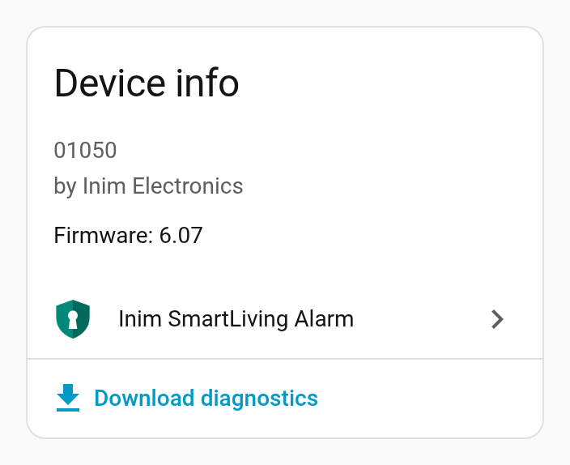

# System report

When you report a problem, a system report tells what the integration knows about your panel: model and firmware, board, the panel's programming as read from it, status, the event log, the integration's options and entities, and connection statistics.

## Sharing a report

1.  Open your panel's device page: **Settings** → **Devices & services** → **Inim SmartLiving Alarm** → your panel.
2.  Click **Download diagnostics** in the *Device info* card.

    { width="344" }

3.  Wait for the file: it takes about 40 seconds on SmartLAN/SI. Commands are not held up meanwhile.
4.  Attach the file to your GitHub issue. If GitHub refuses the file, zip it first.

The same entry is in the menu (⋮) of your panel on the integration's page.

### How much the report shows

The *Diagnostics level* select chooses how much the next report shows. It is disabled by default: enable it on the device page, in the *Diagnostic* section.

| Level | What it contains |
|---|---|
| **Redacted** (default) | Everything public: the programming, status, events with their times, statistics. Names are cut to their first 3 characters, the serial number to its last 4 digits, the board's MAC address to its last 2 bytes; addresses, PINs, phone numbers, key serials and passwords are left out. Safe to post. |
| **Full** | Also the names, the serial number and the network addresses. PINs, phone numbers, key serials and passwords are still left out. |
| **Full confidential** | Everything, including the PINs, phone numbers, key serials and the board's passwords. |

At **Redacted**, one download gives a plain file you can attach to a GitHub issue as it is.

??? note "Full and Full confidential: two files"

    At **Full** and **Full confidential** you get two files from the same reading of the panel:

    1.  The first download is **encrypted** to the maintainer's key: only the matching private key decrypts it. It also holds the Redacted view in clear. **Attach this file to your GitHub issue**; it is the only file to share.
    2.  Download diagnostics once more within 10 minutes to get a **readable copy** of the same report (it holds `PRIVATE COPY`), to check what you are sharing. **Do not share it**: keep it private and delete it when you no longer need it. A notification reminds you of this after the first download. Both files get the same name, so your browser saves the second one with a number added (for example `(1)`): attach the first one, which holds `encrypted` and `redacted_view`, never the one that holds `PRIVATE COPY`.

    Then the level goes back to *Redacted*. Nothing is stored: the report is held in memory only until the second download, for 10 minutes at most.

??? note "What is and is not read"

    The board's own details (its network settings and firmware) are included only when Home Assistant is on the same network as the board. What is never read, at any level: the panel's cloud keys, account ID and address, and the board's internal keys.

## Reading a report

The repository has a small viewer for reports, `scripts/inim_report.py` (Python 3.13 or newer; nothing to install for reading). Download the repository from GitHub, then:

*   `python3 scripts/inim_report.py show REPORT.json` shows a report: a summary and the findings first, then areas, zones, scenarios, codes, devices, outputs, the areas' state now, status, events, the integration's options and the connection. Add `--html report.html` for one page to open in a browser.
*   `python3 scripts/inim_report.py check REPORT.json` says whether a file is the one to attach (the Redacted report, or the encrypted one) or the private copy, which you should not share.

An encrypted report is read with `show REPORT.json --decrypt` (add `--html report.html` for the page); it needs the matching private key and the Python package `cryptography`. It reads the files only: it connects to nothing. You can view your own Redacted report and your readable copy with it; the encrypted file shows its Redacted view.
